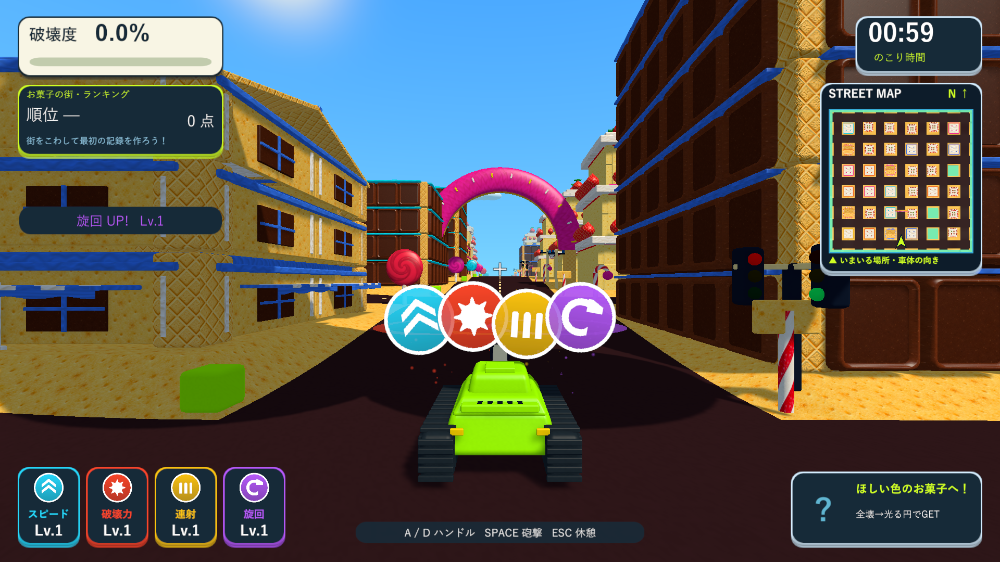
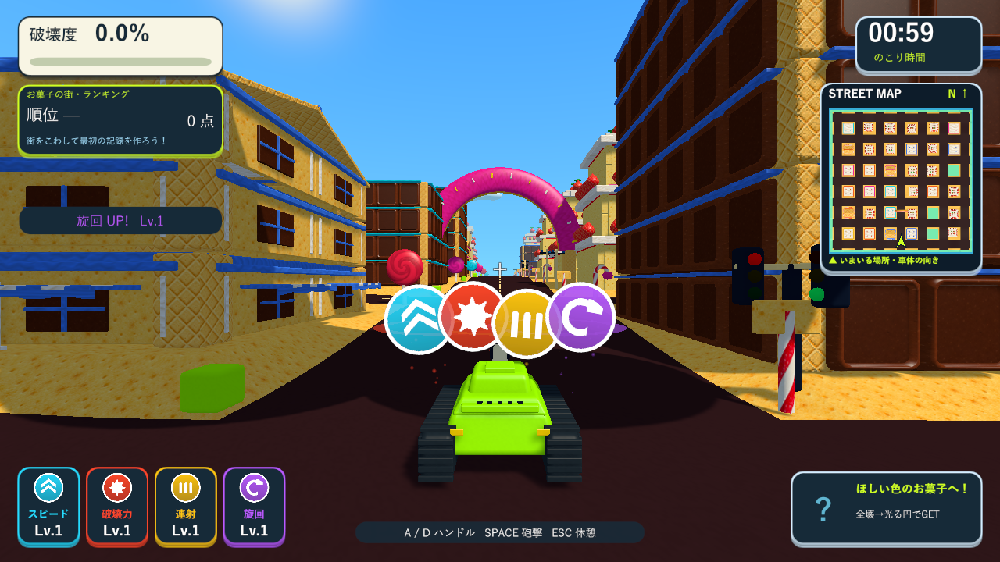

# 取得アイコンの位置・大きさ・重なりと速度

2026-10-10。Issue #5。取得したパワーアップの表示を低く大きくし、端を重ねて、素早く出るように調整しました。

|項目|前回|今回|
|---|---:|---:|
|戦車からの表示高さ|2.8|2.1|
|アイコンの表示サイズ|1.15|1.75（約1.52倍）|
|横の中心間隔|1.35|1.25|
|戦車上への移動時間|0.28秒|0.14秒|
|横移動の追従時間|0.09秒|0.045秒|

大きさより中心間隔を狭くすることで、アイコンの端を重ねています。最初に1.05の間隔で描画したところ記号の一部まで隠れたため、中央の記号を読める1.25へ調整しました。軽い傾きと高さのずれを付け、均一な整列の見え方を抑えています。描画順を固定し、旋回で重なる順が入れ替わることを防ぎました。

移動は出始めを速くするカーブへ変更し、途中の上方向の弧を小さくしました。到着後の0.12秒だけ最大15%拡大して戻り、取得を短く強調します。同じフィールドのQuad・共有材質を引き続き使い、取得時に表示を切り替えません。表示時間は2.2秒、最後の0.28秒で消えます。停止中の表示時間停止、爆散・結果画面での消去、強化の維持と取得上限も前回の処理を使います。

Settingsの`pickupIconHeight`、`pickupIconSize`、`pickupIconSpacing`、`pickupFlyTime`で調整できます。

## 検証

Unity 6000.3.19f1の分離したプロジェクトで、取得演出3件と物理トリガーによる取得1件、計4/4件が成功しました（`Logs/pickup-icon-motion-tests.xml`）。最終的な間隔へ調整した後、取得演出3/3件も再検証して成功しました（`Logs/pickup-icon-motion-final-tests.xml`）。同じQuadと材質の継続使用、外縁の重なりと読み取り用の中心間隔、描画順、移動・旋回中の追従、停止・消去・上限、衝突後の強化維持を確認しています。

Windows x64 Development Buildを作り、既存の`--tank-town-pickup-feedback-smoke`で1920×1080・1280×720の実画面を確認しました。Unityネイティブゲームなので、Skillのブラウザ確認に相当する画面の確認はD3D11 Windowsプレイヤーで実施しています。取得アイコン・戦車の診断配置を使用し、一部オブジェクトを無効にします。ランキングは保存せず、通常プレイの全行程の代わりにはしません。

最終ビルドは`Logs/pickup-icon-motion-final-build.log`で成功し、プレイヤーは`Logs/pickup-icon-motion-final-player.log`でexit 0、8画面・同じアイコンの再使用・4個の表示・移動時間0.14秒・サイズ1.75・復帰0.450秒・衝突爆発による16部材の破壊を確認しました。更新した`Builds/TankTown-PickupFeedback`と既存の6配布先で、実行ファイル・Runtime DLL・resources.assets・テクスチャresS・音声resourceの5ファイルが一致しています。Runtime DLLのSHA-256は`33B9C24D6797CC8624C190F80A717F4A983B6EF72A5C48EDFCC2E16BEC0E2D1A`です。メイン・検証・レビューのソース・素材・meta計233ファイルも一致しています。

[取得前](images/tank-town-upgrade-motion-01-field.png)、[移動途中](images/tank-town-upgrade-motion-02-flight.png)、[単独の表示](images/tank-town-upgrade-motion-03-above.png)、[旋回中](images/tank-town-upgrade-motion-06-driving.png)、[衝突爆発](images/tank-town-upgrade-motion-07-crash.png)、[復帰後](images/tank-town-upgrade-motion-08-recovered.png)。
