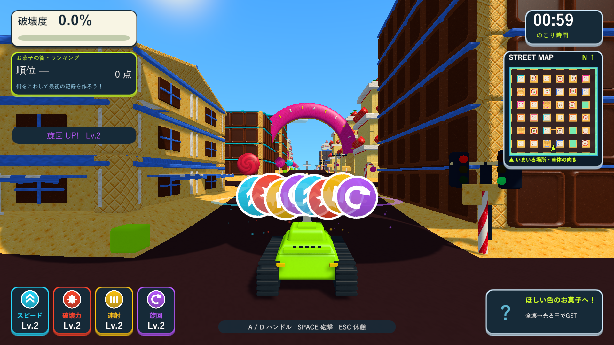

# 取得アイコンを一列へ重ねる変更

2026-10-10。Issue #5。5個以上の取得アイコンも上へ積まず、同じ横一列の中へ重ねるよう変更しました。

4個までは前回の間隔を使い、5個以上では同じ表示幅の中で間隔を縮めます。新しいアイコンを手前に描画し、増えても傾きが大きくなりすぎないようにしました。小さな高さのずれを維持し、段ごとの高さを削除しています。低い位置・大きさ・0.14秒の移動・到着時の拡大・2.2秒の表示・停止中の時間停止・強化の取得処理を維持しています。

## 検証

Unity 6000.3.19f1の分離した検証プロジェクトで、取得・表示停止と消去・衝突復帰のPlayMode 3/3件が成功しました（`Logs/pickup-row-tests.xml`）。取得確認を8個へ拡張し、同じ高さの帯に収まり、4個時点より横幅が広がらないこと、元のQuadと材質を使うこと、移動・旋回へ追従することを確認しました。

Windows x64 Development Buildは`Logs/pickup-row-build.log`で成功しました。D3D11プレイヤーは`Logs/pickup-row-player.log`でexit 0、取得前・途中・単独・4個・1280×720・8個・旋回・衝突・復帰・HUDなしの10画面を確認しています。8個を取得しても同じ一列に収まること、復帰0.450秒、衝突爆発による16部材の破壊も確認しました。取得アイコンや戦車の診断配置を使い、爆発物と通行人を無効にし、ランキングは保存しません。

UIの提案用にHUDなしの実画面・ミニマップ・既存アイコンをPNGへ書き出す処理を、診断フラグが指定された場合だけ追加しています。今回ゲームのHUDの全面変更は行っていません。[新しいUIの提案と操作見本](ui-proposal.md)を用意しました。HTML見本はChromeで操作と2つの解像度を検証しています。

検証したビルドを`Builds/TankTown-PickupFeedback`と既存の6配布先へ反映しました。7か所で実行ファイル・Runtime DLL・resources.assets・テクスチャresS・音声resourceのSHA-256を照合しています。Runtime DLLは`0469E2235A74E16EF59269AAD4DC889AD5F250A150D038824239542AC2EC87C0`です。メイン・検証・レビューのソース・素材・meta計233ファイルも一致しました。

[旋回中の一列表示](images/tank-town-pickup-row-driving.png)。
