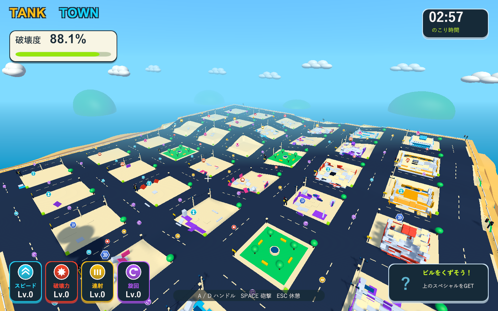
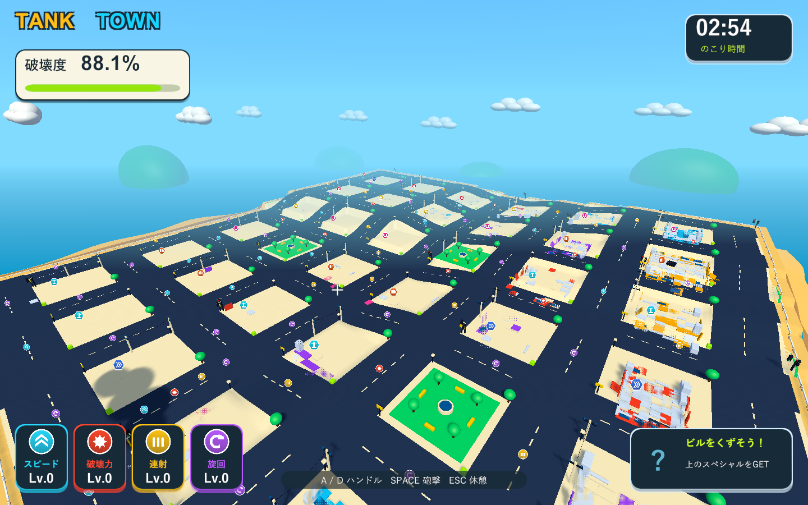

# 破片の消去を場所と時間に分散

2026-10-04。Issue #5。Unity 6000.3.19f1 / URP 17.3.0。

古い破片から消すFIFOをやめ、上限超過時は生存中の破片全体から一様な乱数で選んで消去する。上限は4,000個から2,000個へ変更した。同時に生成した部材が寿命でも一斉に消えないよう、寿命は各破片で3.6〜4.8秒とする。最後の0.45秒のフェードと一時停止中の時間停止を保つ。

管理リストには生存中の破片だけを保持する。破片が消える際に、自身の記録している位置と末尾の要素を交換して削除する。ランダム選択・登録・解除はそれぞれO(1)で、全破片の走査やリスト全体のシャッフルは行わない。Unityの物理演出用乱数とは別の乱数生成器を使う。点火済みの車・燃料・ドラム缶は引き続き通常の消去対象に含めない。

古いグループと新しいグループがどちらも残ること、同時生成した破片が段階的に消えて全ての登録枠を解放することをPlayModeで検証する。ネイティブUnityゲームのためWindows版でも確認する。

追加のストレス診断は33棟を一度に倒壊させ、2,000個の破片が複数の建物に分散して残るか、同じ生成時点の破片が寿命に応じて段階的に消えるかを調べる。通常の時間進行・1440×900・D3D11・60fps上限で、生成前と生成後の各1.5秒のフレーム間隔を計測する。PNG保存と計測は別の時間帯とし、同時倒壊の生成時間は別に記録する。この検証環境の短いストレスケースの値であり、3分間の手動プレイや他機種の性能は測定しない。

|検証|結果|記録|
|---|---|---|
|PlayMode全体|80/80成功、102.11秒。ランダム消去、寿命の段階的な消去、登録枠の解放、上限、停止、物理接触、連鎖、報酬を確認|`Logs/random-debris-tests.xml`|
|Windows Development Build|終了コード0|`Logs/random-debris-build.log`|
|街全体の同時倒壊|2,000個が30/33棟に分散して残る。初期の破片は2,000→1,008→532→0個と消去。終了コード0|`Logs/random-debris-cleanup-player.log`|
|実砲撃後の飛散・実接触|約3秒後に1,207個を保持。床と壁は各6個に分裂し、接触爆発成功。最高4段。終了コード0|`Logs/random-debris-debris-player.log`|
|燃料の点火距離|遠い着弾では点火せず、近い実砲撃で燃料1個が誘爆。終了コード0|`Logs/random-debris-fuel-player.log`|
|街全体の回帰|車2台の誘爆、落下報酬の接地と接触回収、ビーム2.001秒、結果画面まで成功。終了コード0|`Logs/random-debris-city-player.log`|

GTX 1660 Tiを使う検証環境で、生成前は平均59.5fps・95パーセンタイル16.9ms、2,000個の破片が残る生成後は平均59.1fps・95パーセンタイル17.4msだった。それぞれ90フレームの計測。大きな継続負荷はこの短い計測では見られない。一方、33棟全体を同じフレームで倒壊させる生成処理は1,352.9msかかっている。大量の部材分裂・GameObject/Rigidbody生成・倒壊判定の処理を含み、上記の生成後FPSからは除外している。この極端な一括生成の停止時間は残る。

ネイティブプレイヤーログにゲーム例外・シェーダーエラーはない。C#・shader・asmdef・Settings計48ファイルは主作業フォルダー・検証コピー・レビュー用ブランチでSHA-256が一致する。検証したWindows版を `Builds/TankTown` へ配置し、実行ファイルとRuntime DLLのハッシュも確認した。

同時倒壊後、古い建物と新しい建物の両方に破片が散って残る画面。見渡すための診断用カメラ。

同じ生成時点の破片が一斉に消えず、部分的にフェードしていく途中。

