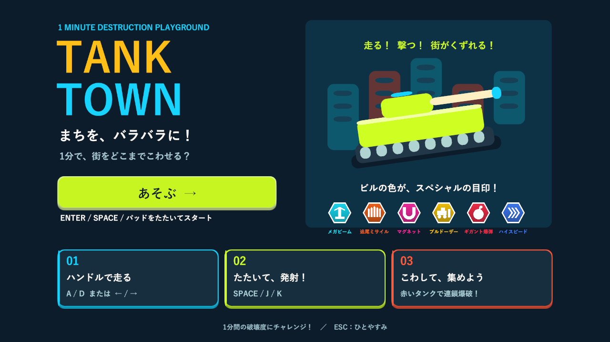
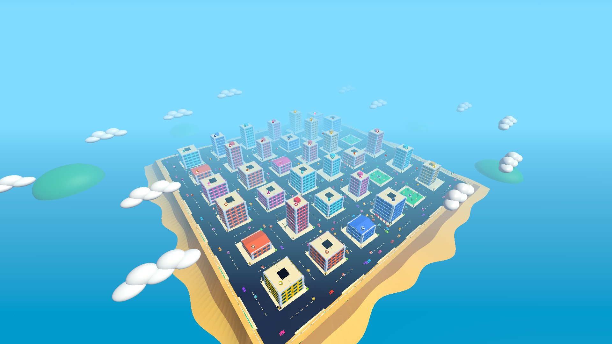
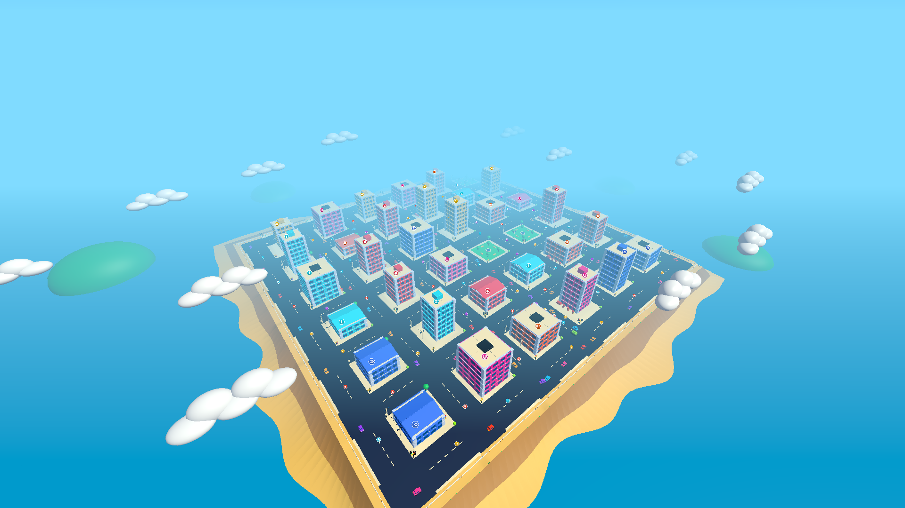
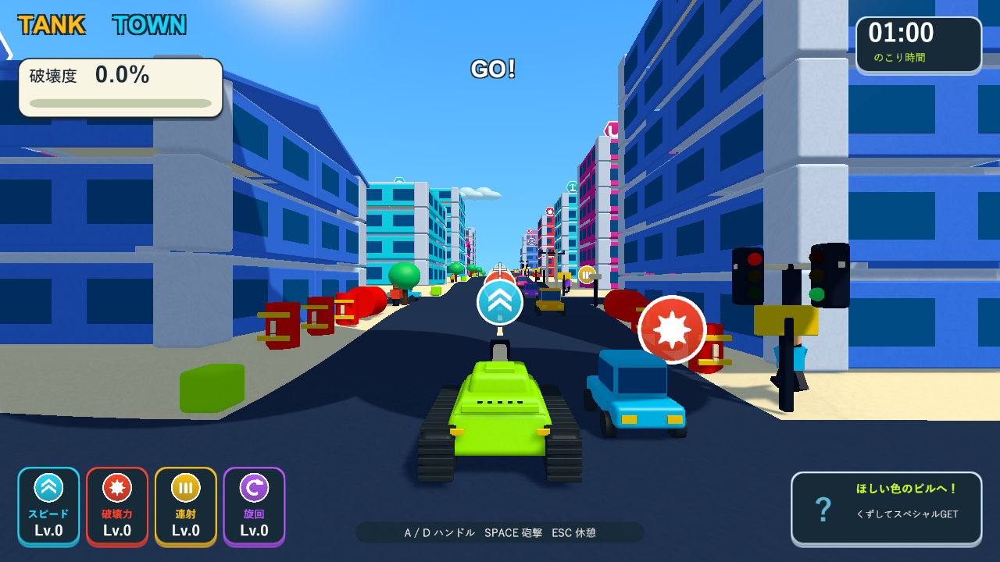
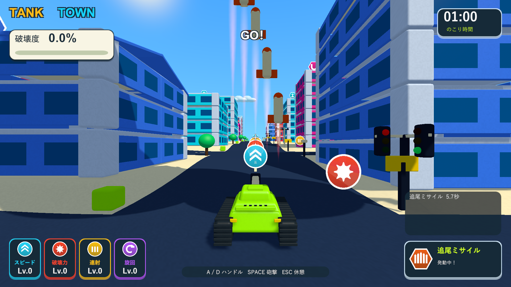
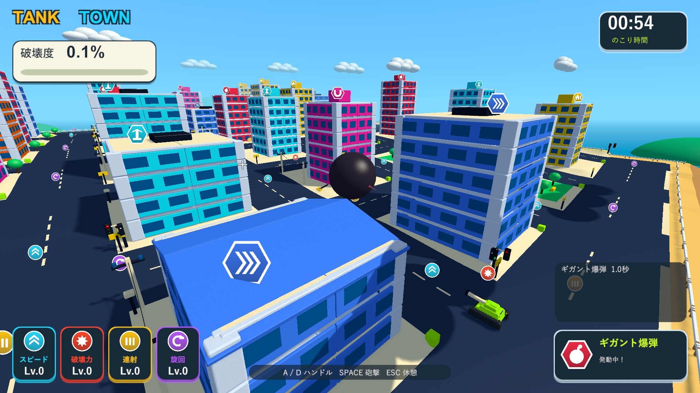
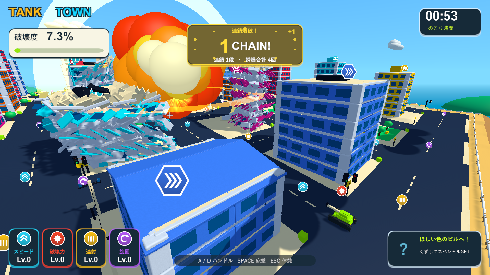
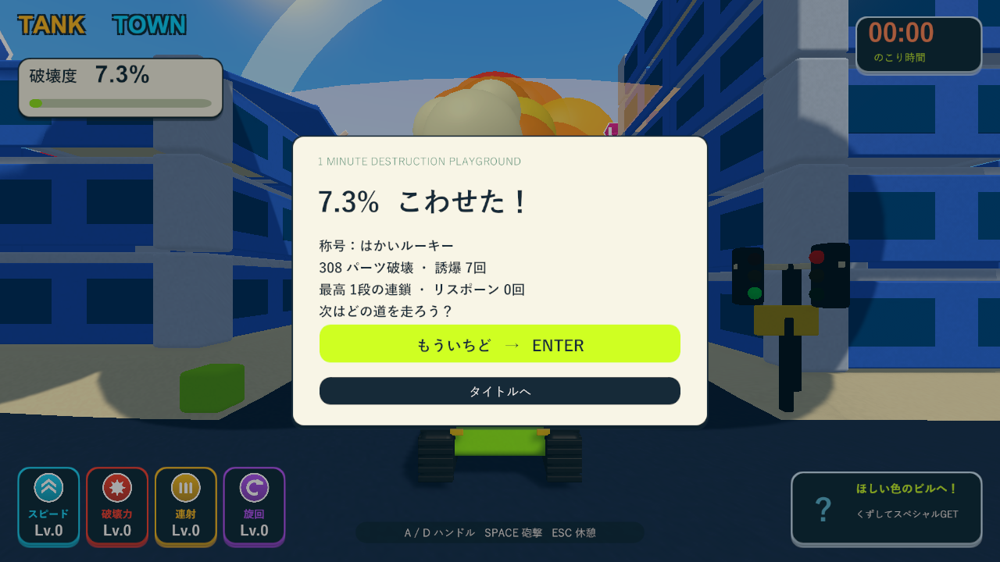

# 前方ミサイル・遠投爆弾・自動生成・1分間の検証

2026-10-05。関連: [Issue #5](https://github.com/Negi310/mission2026-game/issues/5)。Unity 6000.3.19f1 / Windows x64。

ミサイルは選択時に距離90以内・前方左右50度・現在の画面内・カメラから対象まで遮蔽物なしを条件にします。選択後は画面外へ動いても追尾を続け、対象が破壊・退避したときに現在の視界から選び直します。対象がない場合は前方の地面を狙います。巨大爆弾は前方速度18から38、導火時間3秒から1.5秒。接触破壊・半径30の大爆発は継続します。

建物の形・階数と報酬を独立に選び、外壁に報酬の色を使います。水色＝ビーム、オレンジ＝ミサイル、ピンク＝磁石、黄色＝ブルドーザー、赤＝爆弾、青＝高速です。報酬は引き続き上階から物理的に落下し、建物を60%以上破壊すると回収できます。新しいラウンドで建物・公園・アイテム・丘の形をランダム生成します。道路の接続は格子を維持し、建物の足元は平坦です。標準で33棟・3公園・全6種類を確保します。[生成仕様](random-town-design.md)。

時間は60秒へ変更し、タイトル・HUDも1分に統一しました。開始直線の4種類のパワーアップを残し、ランダム配置が開始地点へ重なって意図せず初期能力を上げることを防ぎます。生成はシードで再現でき、通常の再挑戦は新しいシードを使います。

| 検証 | 結果 | 記録 |
| --- | --- | --- |
| 全PlayMode | 102/102成功、135.70秒。以前の97件と今回の5件。100通りの生成・全色と全形の組み合わせ・平坦な足元・道路の連続性・実際の外壁色と報酬・新しい街での再挑戦・前方/後方/側方/遮蔽/旋回後の再選択・爆弾の移動と短い導火時間・1分の終了を確認 | Logs/random-town-final-tests.xml |
| 結果見出しの修正後のPlayMode | 11/11成功、12.13秒。生成5件と表示6件。非表示の結果画面を含めて3分の表記がないことを確認 | Logs/random-town-ui-tests.xml |
| Windows Development Build | 成功 | Logs/random-town-build.log |
| Windows実画面 | 成功。シード2026・67541で33棟・3公園・6色。前方の車への追尾命中1回、爆弾の水平速度37.91・導火時間1.5秒、結果まで終了。タイトル・通常HUD・結果の1分表記を確認 | Logs/random-town-player.log |

最初の全件実行では、以前の固定公園の場所へ建物が配置されることと、ランダムアイテムが開始地点で自動取得されることを検出しました。開始地点の配置は実装を修正し、地形だけを検証する走行テストは建物・小物から分離しました。坂道を登る検証は生成結果の実際の坂を選びます。木との接触による旋回の検証は、地面に従うピッチを許容し、水平な向きの維持を確認しています。

Windows実画面の確認は`--tank-town-generation-smoke`で行います。ゲーム本体の描画とCanvasを使用し、全景・爆弾は診断用カメラ、車の経路と戦車位置は診断で固定します。時間終了の確認は残り0.08秒まで時間を進めてから通常更新で終了させます。手動で1分間プレイした難易度評価やフレームレート測定は今回の確認に含めていません。

実画面で発見した結果カードの旧「3 MINUTE」表記を修正し、非表示中の画面も検証対象に追加しました。爆発画像は火球が広がるまで0.12秒待って撮影します。この最後の撮影時刻調整は診断専用です。

作業元・検証用の分離プロジェクト・レビュー用worktreeで、コード・シェーダー・設定・音源・メタデータ143ファイルのSHA256一致を確認しました。検証済みビルドを`Builds/TankTown`と`Builds/TankTown-LocalBlast`へコピーし、両方の実行ファイル・ランタイムDLL・resources.assetsが検証元と一致することを確認しています。

