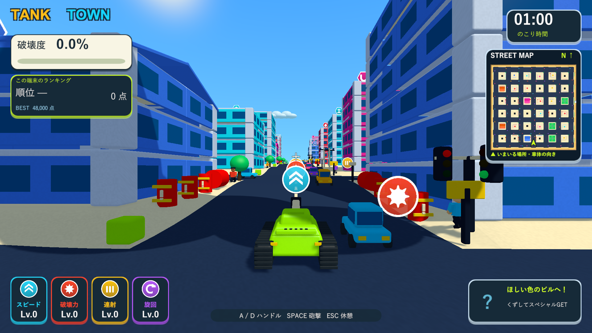
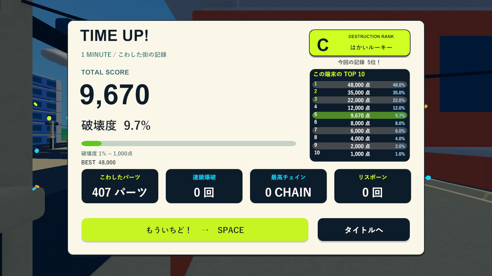

# ランキング・ミニマップ

2026-10-05。[Issue #5](https://github.com/Negi310/mission2026-game/issues/5)。

プレイ中に街全体の状況と自分の記録を確認できるよう、実描画のミニマップと端末内ランキングを追加しました。

## ランキング

スコアは既存の `round(破壊度 × 1000)` を使用します。左のHUDにスコア・暫定順位・次の順位に必要な点数を表示し、タイムアップで1回だけ登録します。結果画面では上位10件の順位・点数・破壊度を並べ、今回の行を緑で強調します。破壊度から決まるS/A/B/Cの称号とは別の順位です。記録がない行は「—」で表示し、架空の相手は入れません。

保存先は端末のPlayerPrefs `TankTown.Ranking.v1`（JSON）です。各記録に識別子・スコア・街のシード・UTC日時を保持し、上位10件だけ残します。アプリの再起動、街の再生成、タイトル帰還後も読み戻します。同点は以前の記録を上位に置きます。0点は登録せず、11位以下は圏外と表示します。既存の `TankTown.BestScore.v1` は読み込み、以前のベストが新しい一覧より高ければ引き継ぎます。不完全なJSONや無効なレコードは読み飛ばし、以前のベストから復旧します。オンライン通信や名前入力は追加していません。

## ミニマップ

右上の時計の下に正方形の街の映像を配置します。実際に生成した街を真上から正投影で描き、北（世界座標+Z）を常に上にします。戦車の表示は縁取りした黄色い矢印で、世界座標のX/Zから位置を求め、車体の水平方向へ回します。砲塔が先行して旋回している場合も車体の向きを表示します。端では矢印を内側に収めます。

街の映像は384×384のRenderTextureに毎秒4回描き直し、壊れた建物も変化します。矢印は毎描画フレーム更新します。一時停止中は再描画を止め、結果・タイトル中は非表示です。画面が短い場合はカードを縮小して下のアイテム表示との重なりを抑えます。カメラの追従やズームを加えず、通常の運転画面の酔い対策を維持します。

専用カメラはMainCameraタグ・AudioListenerを持たず、通常のカメラ更新を無効化してURPの描画要求だけで更新します。HUD・浮遊アイテム・通行人・飛散破片を除外し、マップでの影・ポスト処理も省略します。元の街と地形・建物の色をそのまま使用します。再挑戦時には古いRenderTextureとカメラを解放して新しい街を映します。

## 検証

Unity 6000.3.19f1の分離プロジェクトで、関連PlayModeテスト22/22が成功しました（24.19秒、`Logs/ranking-minimap-tests.xml` / `.log`）。全PlayModeも119/119成功しました（158.36秒、`Logs/ranking-minimap-full-tests.xml` / `.log`）。順位の予測・同点の順序・上限・0点・JSONの読み戻し・旧ベスト移行・破損データ復旧・タイムアップで一度だけ登録・文字の収まり・車体に合わせた矢印・座標変換・再挑戦時のカメラとRenderTextureの解放を確認しています。既存の砲撃・倒壊・車・アイテム・カメラ・画面遷移の検証も通りました。

Windows x64 Development Buildが成功しました（`Logs/ranking-minimap-build.log`）。Skillの画面確認は、ネイティブゲームのためブラウザではなくD3D11実プレイヤーで行いました。`--tank-town-ranking-minimap-smoke` はexit 0で完了し、1920×1080と1280×720のHUD・東向きの矢印・破壊後の街・TOP 10・Space再挑戦後の別の街を実描画で撮影しました。車体位置とマップ座標の一致、北の固定、旧カメラの解放、順位5位の9,670点が再挑戦後も読み戻せることを確認しました。破壊・位置変更後のマップは3,806ピクセルが変化しました（`Logs/ranking-minimap-player.log`）。

診断画像のランキングには表示確認用の記録を専用のランダムなPlayerPrefsキーへ保存しています。通常起動のランキングには追加せず、終了時に診断キーだけを消します。自動テストは原則メモリ上の記録、保存テストは個別のランダムなテストキーを使うため、既存プレイヤーのベスト・順位を変更しません。確認範囲は自動テストと診断入力による実描画であり、異なる端末での長時間のフレームレート測定は行っていません。

作業元・検証プロジェクト・レビュー用worktreeのコード・設定・シェーダー・音源・メタデータ160ファイルのSHA256一致を確認しました。検証済みWindowsビルドを `Builds/TankTown` と `Builds/TankTown-LocalBlast` に反映し、両方のEXE・TankTown.Runtime.dll・resources.assetsが検証元と一致することも確認しました（`Logs/ranking-minimap-hashes.json`）。

