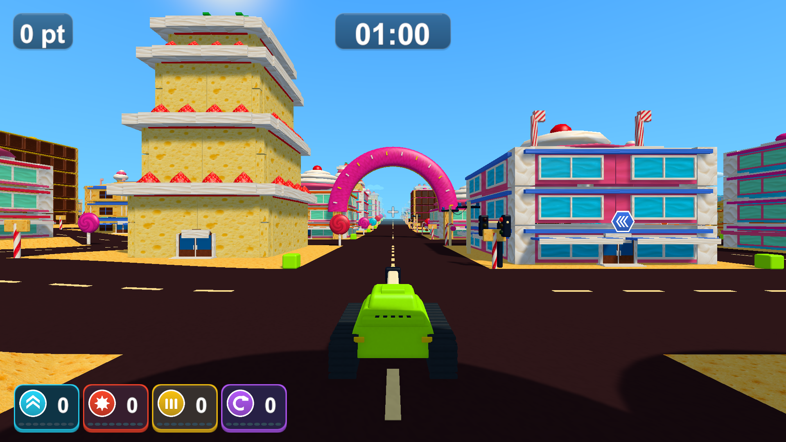
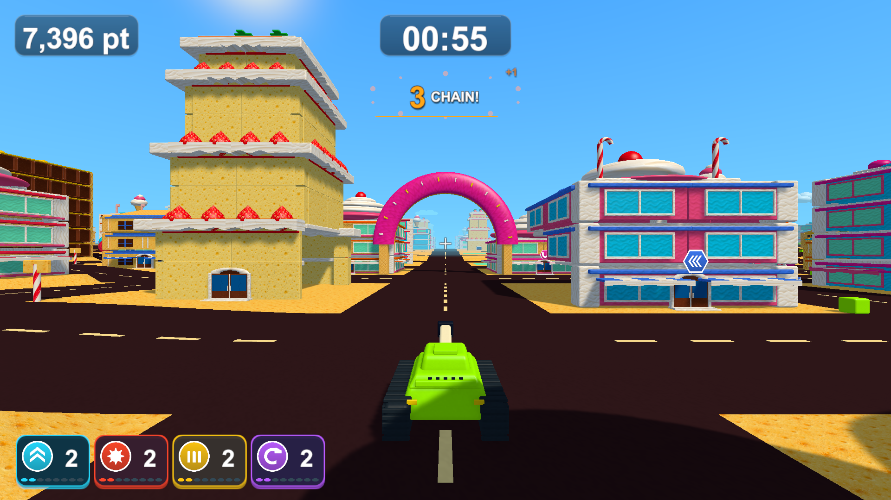

# 控えめな質感と小さめのHUD

同日の追加調整でptと時間の文字の上下余白を揃えています。[最新の位置調整と検証](header-text-centering-validation.md)。以下はその直前のデザイン調整の記録です。

2026-10-13。ptと時間の平坦な背景を、小さい角丸のパネルへ整えました。共用の64×64テクスチャ2枚で淡い上下の陰影と細い縁を描き、短いハイライトと柔らかい影を足しています。文字の太い縁取りは外し、明るい数字と控えめな影で読みやすさを保ちます。

時間のフォントは74から58、ptは64から50へ約2割縮小。時間の背景は300×96から226×72へ詰め、ptの背景は数字の長さに追従します。チェインも文字を少し小さくし、太い縁と拡大の勢いを控えめにしています。背景カードは戻していません。下部のアイコン・数字・効果ゲージは共通倍率で6%縮小し、取得のカウントアップと重なり回避を保ちます。

[実画面の調整前後](minimal-hud-review.html)の「最新」で確認できます。説明文・ミニマップの削除、アイテム効果・スコア・制限時間・結果保存・全画面設定は維持しています。

- 表示・取得と停止／効果終了・チェイン・ポイントと結果保存の既存PlayModeテスト10/10成功（`Logs/refined-hud-tests.xml`）。
- Unity 6000.3.19f1でWindows x64 Development Build成功（`Logs/refined-hud-build.log`）。お菓子の街・遊園地それぞれ16画面、計32画面の診断が終了コード0（`Logs/refined-hud-candy-player.log`、`Logs/refined-hud-amusement-player.log`）。1920×1080、1280×720、1440×900、1280×1024で、UIの範囲・非重複・文字の収まりと同時効果を確認しました。撮影には停止した戦車・診断用の取得とシード2026を使います。
- Chromeで実画面13枚、調整前後と場面の切り替え、1920/1280/720/390px幅、原寸リンクとエラーがないことを確認（`Logs/refined-hud-browser.log`）。Unity実画面を閲覧するページのブラウザ検証です。

ローカルの更新版は`Builds/TankTown-RefinedHUD/TankTown.exe`です。共通のTankTown・TankTown-Amusement・TankTown-GameplayUIも、起動中でなければ同じ内容に更新します。既存のGitHub v0.1.0配布物は変更していません。

