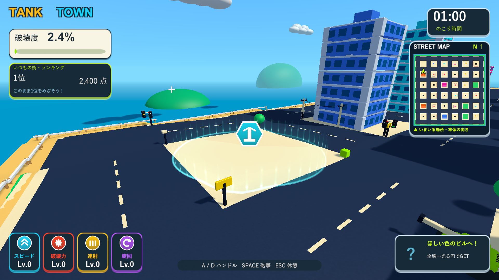
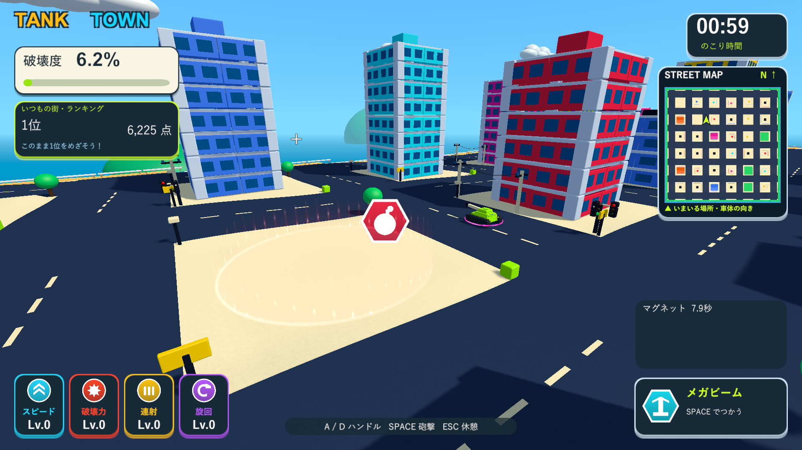
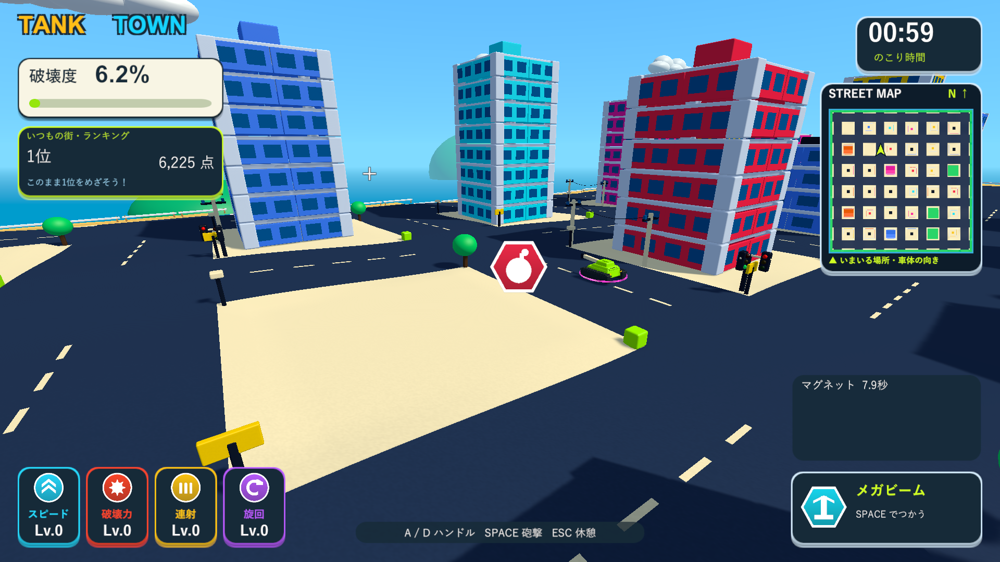

# 全壊後の円形スペシャルエリア

2026-10-07。Issue #5。建物の屋上に配置して落下させていたスペシャルを、全壊後に現れる円形エリアへ変更しました。

## 動作

- 部材がすべて分離すると、建物の真下の中心にエリアを一度だけ出します。屋根だけの破壊、部分倒壊、最後の部材が残った状態ではアイコン・エリアとも表示しません。破片の削除後も全壊の判定を保持します。
- エリアの半径は建物幅×0.65、最低7。現在の建物では約9.36〜13で、中心に5.2の大きなアイコンを浮かせます。種類と色は元の建物の報酬を引き継ぎます。
- 外縁の輪と薄い床の光、上へ流れて消える高さ3.8の光を表示します。外縁と床の頂点を地形へ合わせています。専用の加算シェーダーで光を流し、エリアごとのUpdate・ライト・粒子の更新は使いません。影とミニマップの描画対象にも含めません。
- 戦車の中心が円の内側へ入って取得に成功すると、アイコンとエリアを消します。車体が円の外から少し触れただけでは取得しません。保持枠が満杯なら両方を維持し、次の砲撃で枠が空いた後に取得できます。
- マグネットはアイテムだけを移動させます。円は元の敷地の中心に固定し、アイテムが水平面で外縁を越えた時点で円を消します。円が消えた後もアイテムの吸引・取得を続けます。保持枠が満杯でもアイテムを失いません。抽出後に吸引が途切れたら通常の落下・地面との衝突へ戻します。
- 操作と発動方法、6種類の効果、通常の能力強化、ステージ選択とランキングは維持しています。遊び方とHUDの取得案内を円形エリアに合わせました。

## 検証

分離したUnity 6000.3.19f1プロジェクトで全体135件を実行し、134件が成功しました。残る既存ミサイルのテストは、並びを保証しない検索結果の先頭を最初に発射される弾として扱っていました。5発のどれかが上昇することを確認する方式へ修正し、報酬・アイテム・極端なスペシャル・生成・画面遷移の最終40/40件が成功しました。ゲーム内のミサイル挙動は変更していません。

報酬の非表示、屋根・部分破壊による取得不可、最後の一部材での解放、一度だけのエリア生成、円の端での取得と消去、マグネット中の位置固定と外縁を越える時点の消去、満杯時の保持、抽出後の重力復帰、破片消去後の全壊状態保持を確認しました。既存の6種類の発動、ミサイルと他武器の併用、ランキング・街の生成も関連検証に含めています。

ログは`Logs/reward-area-full-tests.xml`、`Logs/reward-area-final-tests.xml`。数値はUnityのワールド単位です。ネイティブUnityゲームの画面確認は、Skillのブラウザ確認に相当するD3D11のWindowsプレイヤー実描画で行いました。診断はランキングを保存しません。

Windows x64 Development Buildは`Logs/reward-area-delivery-build.log`で成功。従来33棟と大型132棟の両方で専用の実描画診断がexit 0で完了しました。エリアの光のシェーダーが動作すること、円の端からの取得、固定された円の内側での吸引、外縁を越えた時の消去、満杯でもアイテムが残ること、保持武器を実際に使って枠を空けた後の回収を確認しました。ログは`Logs/reward-area-delivery-player.log`と`Logs/reward-area-big-player.log`です。

1920×1080の保存画面で円の外縁・上る光・中心のアイコンとHUDを確認しました。検証済みの実行版を`Builds/TankTown`と`Builds/TankTown-LocalBlast`へ反映しました。メイン・検証プロジェクト・レビュー用ブランチのソース、設定、音声、meta計182ファイルと、両配布先の実行ファイル・Runtime DLL・resources.assetsのSHA-256一致を確認しています。旧方式を記録した過去の検証文書は当時の履歴として残しています。

- Runtime DLL：`A5395B1DE0A6317787E8ADB95DED216A1D9A4C0F2EF910691A5BF626CC092D87`
- resources.assets：`49982098011D4EA7D3A7CB305659A415862F8A170B8753BE01B19B696C0B83B5`

