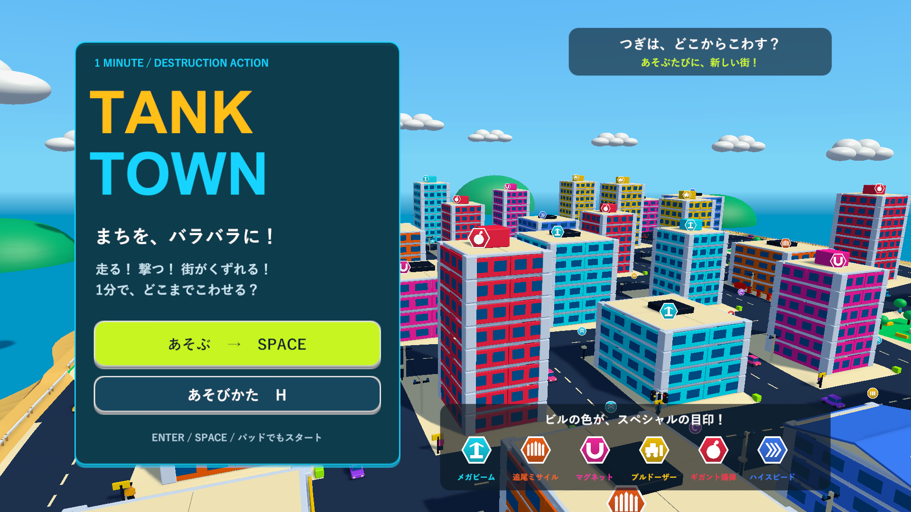
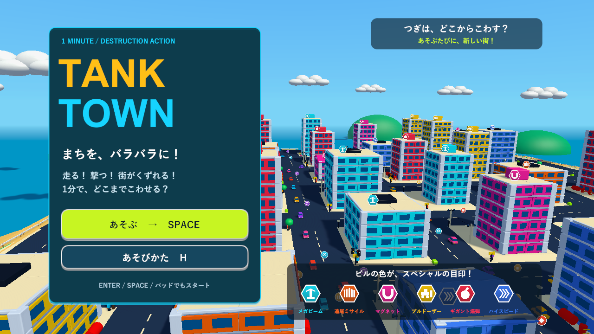
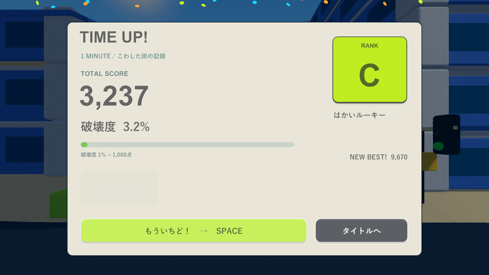
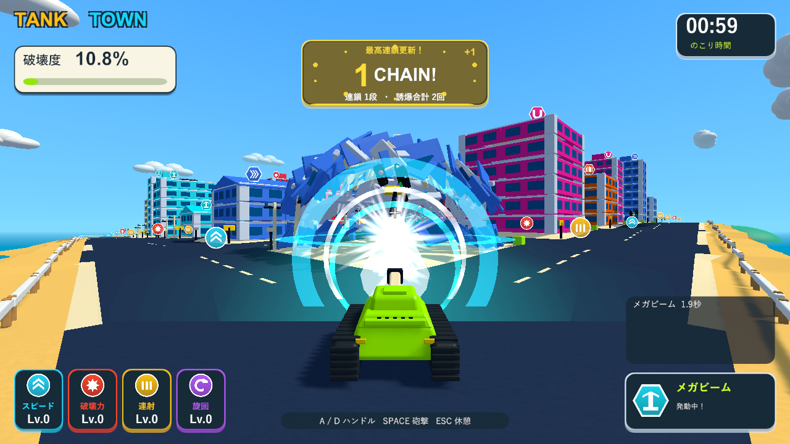
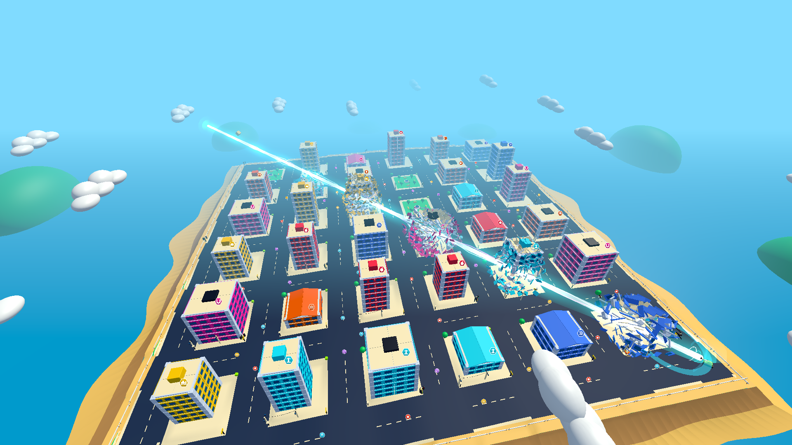

# 屋根の高さからの巡回・演出速度・全域レーザー

2026-10-05。[Issue #5](https://github.com/Negi310/mission2026-game/issues/5)。

タイトルをビルの屋根に近い高さから街を回り込む視点にし、開始と結果の演出を少しだけゆっくりにしました。レーザーはフィールドの端から端まで届く長さへ延長しました。

| 項目 | 変更前 | 現在 |
| --- | --- | --- |
| 3・2・1の各表示 | 0.16秒 | 0.22秒 |
| GO!の表示 | 0.32秒 | 0.40秒 |
| リザルトのカード登場 | 0.20秒 | 0.26秒 |
| スコアの数え上げ | 0.72秒 | 0.95秒 |
| 各記録の数え上げ | 0.35秒 | 0.46秒、登場間隔0.065秒 |
| タイトルの高さ | フィールド半幅の1.6倍、標準214.4 | 一番高い屋根・屋上設備の上端より9上、最低38 |
| タイトルの回転半径 | フィールド半幅の1.10倍 | 1.22倍 |
| レーザー射程 | 105 | 400 |

タイトルの注視点は一番高い屋根の35%の高さにし、屋根と外壁が見える緩い見下ろしにします。高さは街の生成時に一度求め、毎秒3.5度の巡回中は一定に保ちます。シード2026の実プレイヤーでは高さ48.1、見下ろし角11.5度でした。タイトルと開始前の街・タイマーの停止、覆った画面での戦車視点への切り替え、Spaceで結果演出の途中から即座に再挑戦する操作は維持しています。

標準フィールドは一辺268、対角線約379です。射程400のレーザーは描画とカプセルの破壊判定へ同じ値を渡します。持続2秒、半径9、砲塔旋回倍率0.18は引き続き使用します。遠くでも砲口の向きに沿って飛ぶので、部材に命中する高さは砲身の仰角と地形にも従います。

Unity 6000.3.19f1の分離プロジェクトで、画面フロー・スペシャル・移動対象を含むPlayModeテスト22/22が成功（35.52秒）しました。対角線方向の反対側の角に置いた部材へ実際の砲撃入力で命中し、射程の外の部材は残り、光の端と破壊判定の射程が同じであることを追加検証しました。証跡は`Logs/rooftop-beam-tests.xml`と`.log`です。Windows x64 Development Buildも成功しています（`Logs/rooftop-beam-build.log`）。

Skillの画面確認は、ネイティブゲームのためブラウザではなくD3D11のWindows実プレイヤーで行いました。`--tank-town-round-flow-smoke --tank-town-beam-range-check`でタイトル・遊び方・3/2/1/GO・結果・Space再挑戦とレーザーを描画し、exit 0で完了しました（`Logs/rooftop-beam-player.log`）。確認範囲は自動テストと診断入力での実描画であり、全PlayModeの再実行や手動の1分間の難易度評価は行っていません。

レーザーの診断は戦車を角へ固定し、実際のレーザーで距離345.9の対角の部材を破壊します。表示の長さ400、フィールド対角線379、遠方の部材の分離を確認しました。街全体が写るレーザー画像は診断用のカメラで、通常プレイのカメラも別に撮影しています。最後の診断ではSpaceから次のプレイまで1.217秒でした。街の生成時間は環境に依存します。

作業元・検証プロジェクト・レビュー用worktreeのコード・シェーダー・設定・音源・メタデータ152ファイルのSHA256一致を確認しました。検証済みビルドを`Builds/TankTown`と`Builds/TankTown-LocalBlast`へ反映し、両方のEXE・TankTown.Runtime.dll・resources.assetsが検証元と一致することを確認しています。

