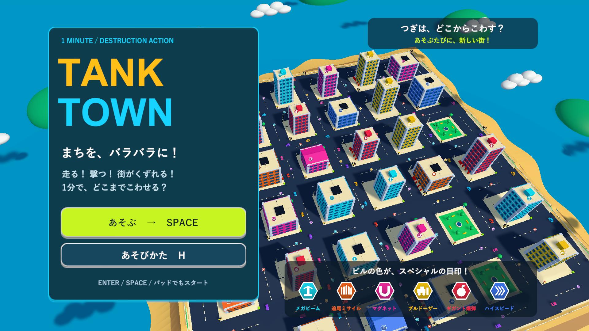
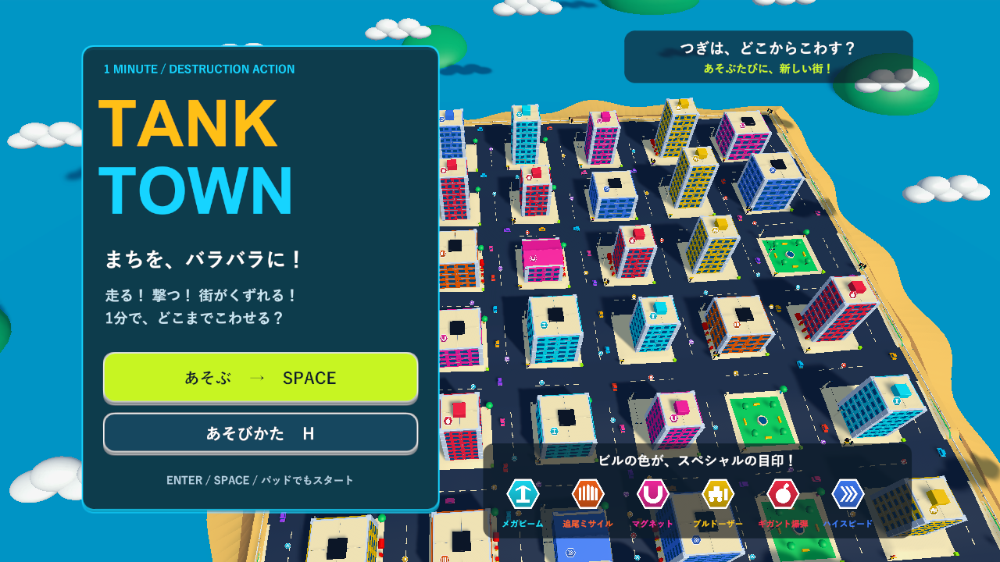
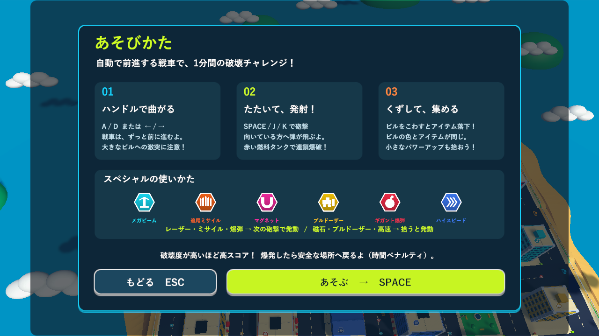
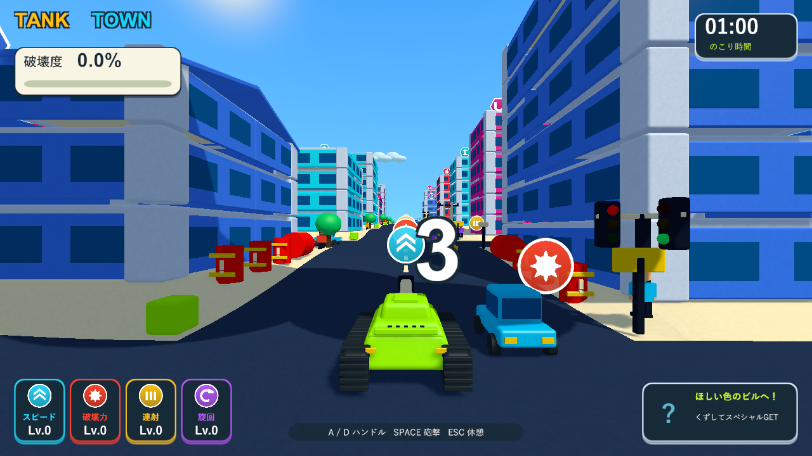
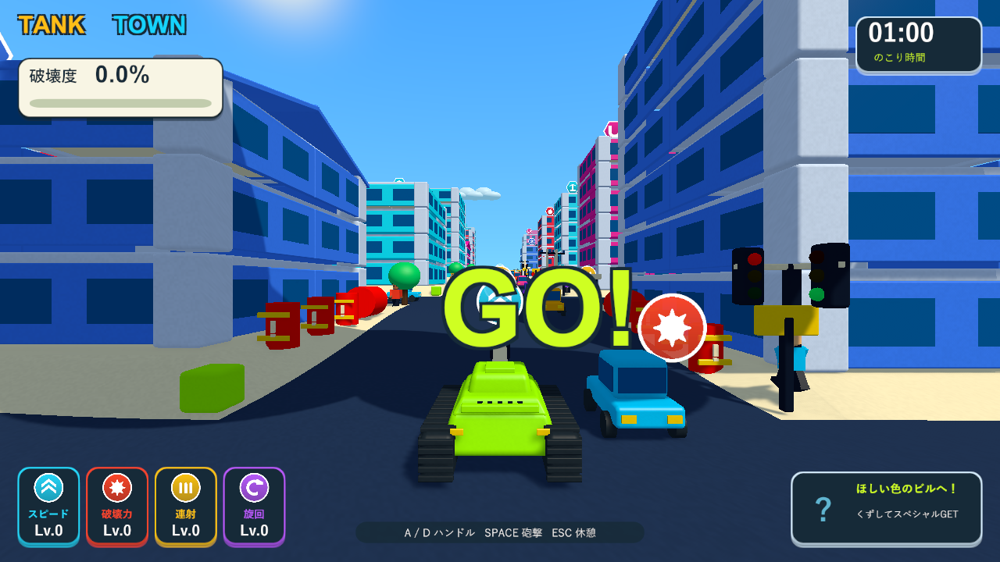
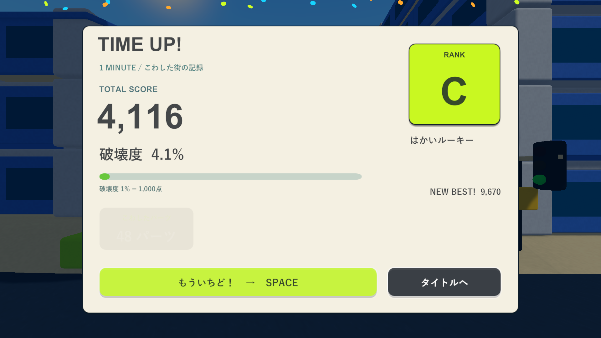
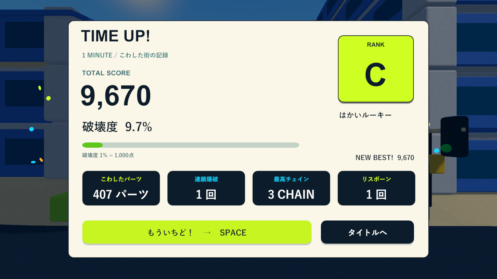
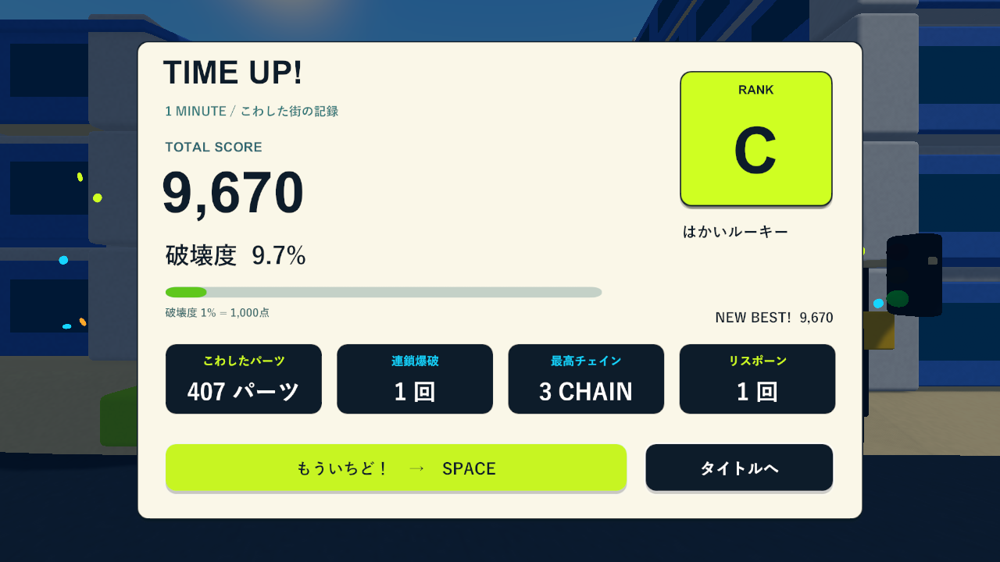
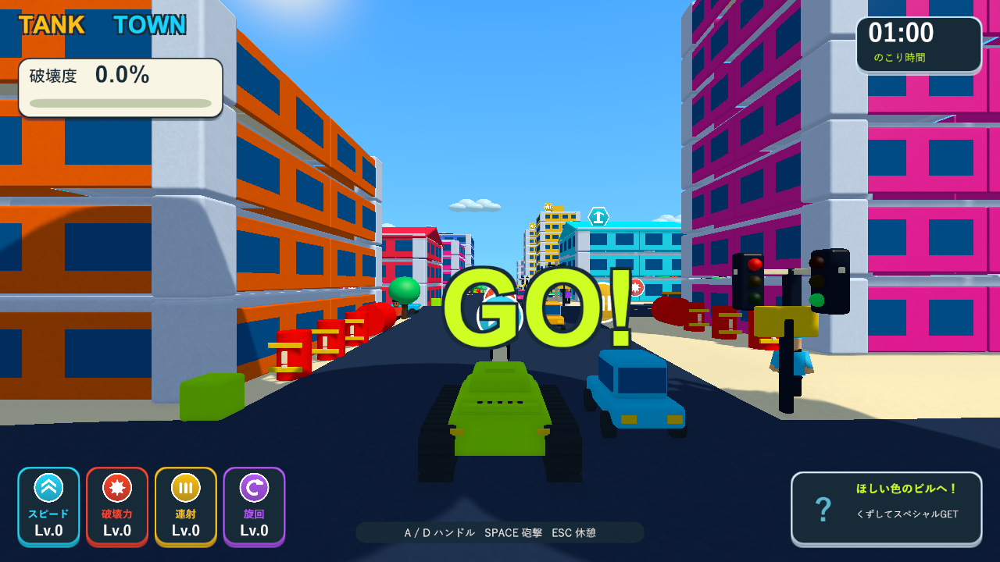

# タイトル・リザルト・高速開始の検証

2026-10-05。[Issue #5](https://github.com/Negi310/mission2026-game/issues/5)。仕様は[画面フロー設計](round-flow-design.md)。

実装した内容は、実際の生成街を上からゆっくり巡回するタイトル、独立した遊び方、スコアと記録のリザルト、Spaceによる即再挑戦、短い暗転と3・2・1・GO!です。開始・結果の演出は実時間で動かし、開始前の街・戦車・制限時間を停止します。再挑戦中の連打では二重開始や砲撃をしません。

Unity 6000.3.19f1の分離プロジェクトで検証しました。ネイティブWindowsゲームなので、Skillの画面確認はブラウザではなく、D3D11の実プレイヤーと実際のCanvas描画で行っています。ユーザーのUnity Editorと既存のプロジェクト設定を検証用に操作しません。

| 検証 | 結果 | 証跡 |
| --- | --- | --- |
| 新しい画面フローのPlayModeテスト | 6/6成功、12.25秒。上空の巡回・停止、実際のH/Esc/Space入力、全カウント、開始中の入力抑制、結果の正確なカウントアップ、演出途中の再挑戦と二重開始の防止、タイトルへの復帰 | Logs/round-flow-tests.xml / .log |
| 既存を含む全PlayMode | 108件中107成功、145.86秒。リザルトで非表示となるチェインの内部透明度に1件の退行を検出 | Logs/round-flow-full-tests.xml / .log |
| チェイン修正と画面フロー・報酬の再確認 | 18/18成功、29.28秒。OnDisableでチェインの透明度を0へ戻す修正を確認 | Logs/round-flow-regression-tests.xml / .log |
| 最終のカメラ・HUD・画面フロー | 19/19成功、25.77秒。タイトル専用の影・霧設定を含む最終ソースで成功 | Logs/round-flow-final-tests.xml / .log |
| Windows x64 Development Build | 成功 | Logs/round-flow-build.log |
| D3D11実画面・入力・再挑戦 | 成功、exit 0。13枚を描画。街の巡回、Hで遊び方、3/2/1/GO、正確な結果、Spaceで新しい街へ再挑戦、プレイ中のSpace砲撃を確認 | Logs/round-flow-player.log |

全件実行で発見した1件は関連18件を再実行して修正を確認しています。最終ソースでの全108件の再実行は行っていません。確認範囲は自動テストと診断入力での実描画で、手動の1分間の難易度評価や一般的なフレームレート測定は含みません。

Windows実画面は`--tank-town-round-flow-smoke`で撮影します。タイトル・開始・結果には通常のカメラを使い、開始演出も省略しません。H/Esc/SpaceはInput Systemへ仮想キーボードの状態を送り、通常のTankInput.Updateで処理します。非表示の診断ウィンドウで入力がフォーカスに遮られないよう、診断時のみバックグラウンド入力と仮想デバイスを有効にします。通常プレイのフォーカス離脱時の一時停止は維持します。

結果画面の診断では、5棟の支持を外す実際の破壊と、場外での連鎖記録1回を作り、戦車は固定します。制限時間を進めて結果へ移り、407部材・9,670点・連鎖1回・最高3段・リスポーン1回を表示したことを確認しました。診断中はベストスコアを保存しません。再挑戦時は再現用にシード2026から67541へ切り替え、0部材・残り60秒・武器なしの新しいラウンドを確認します。

この環境の診断では、Space入力から新しい街のプレイ開始まで1.064秒でした。これは1回の実プレイヤー診断の値で、街の生成や描画時間は環境に依存します。演出そのものは開始時0.10秒の暗転・0.12秒の復帰・各0.16秒の3/2/1、再挑戦時は0.10秒の暗転・生成・0.12秒の復帰・同じカウントです。完全に覆ったフレームで視点を切り替え、操作開始時のGO!は0.32秒で消えます。

1920×1080と1280×720の実画面で文字とボタンが収まることを確認しました。作業元・分離検証プロジェクト・レビュー用worktreeでコード・シェーダー・設定・音源・メタデータ152ファイルのSHA256一致を確認しました。検証済みのEXE・TankTown.Runtime.dll・resources.assetsをBuilds/TankTownとBuilds/TankTown-LocalBlastへ反映し、両方が検証元と一致します。

