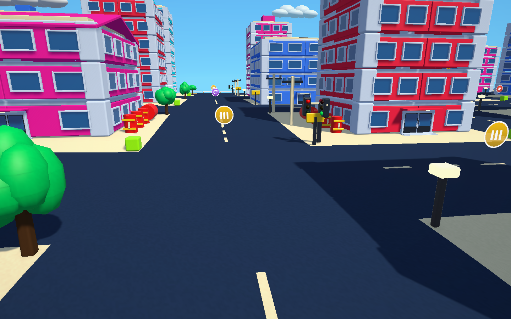
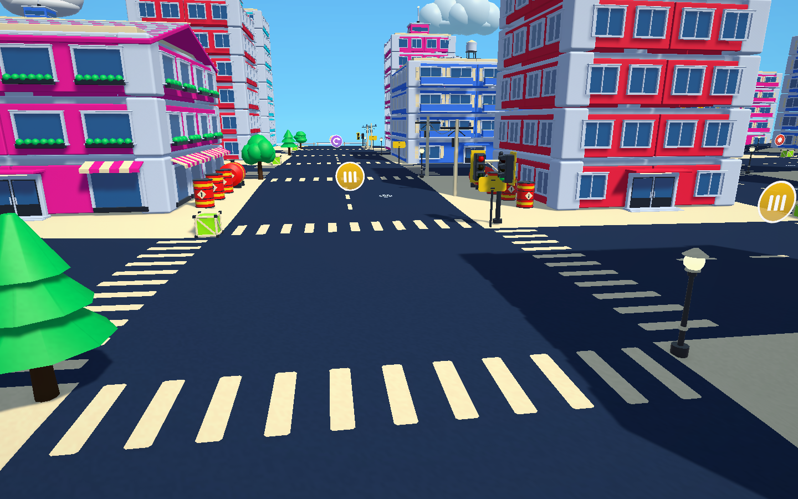
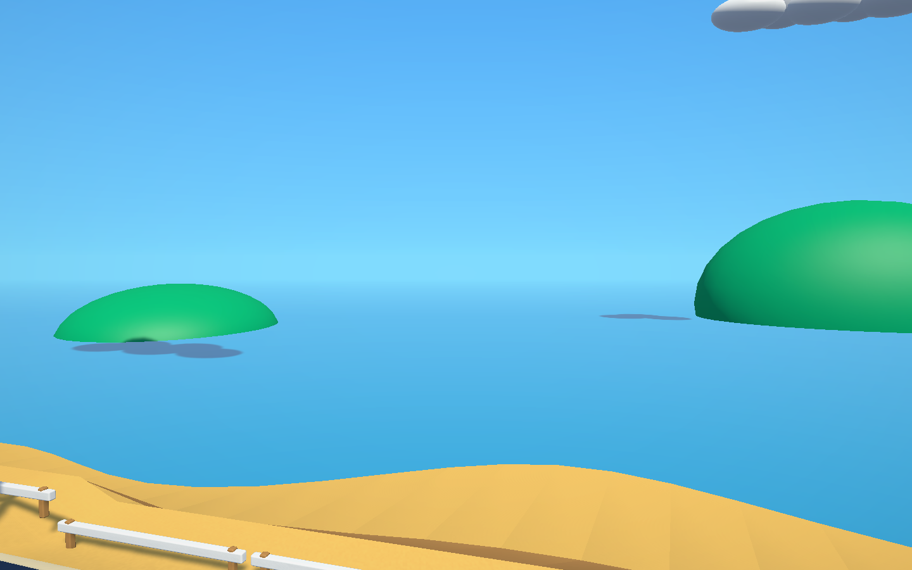
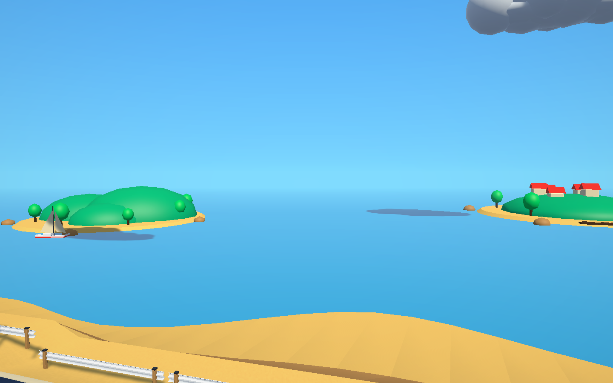
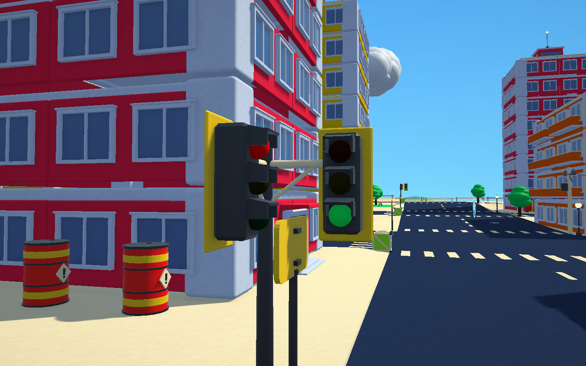
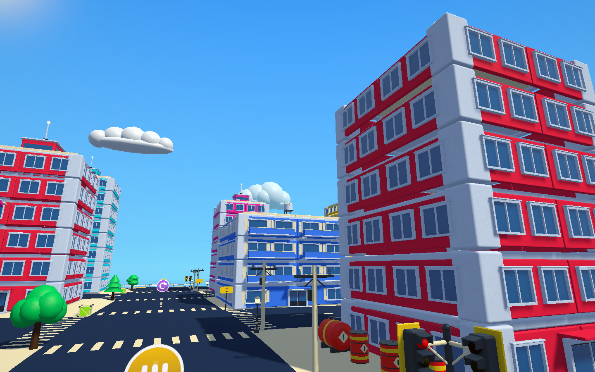
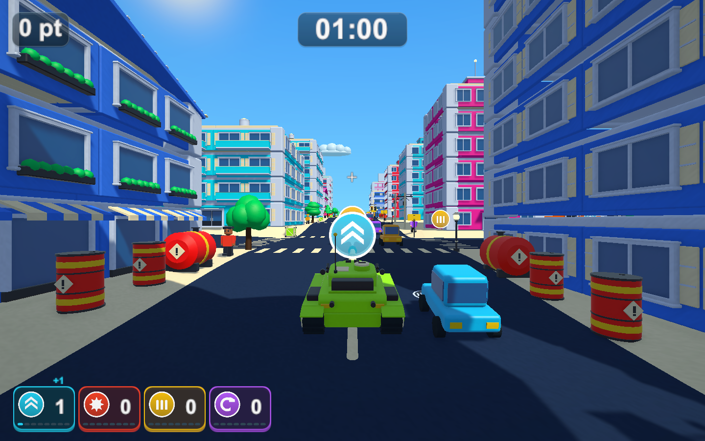

# 道路・雲・遠景をBlenderの部品で作り直す

2026-10-23

## 変更内容

[街の部品](city-kit-validation.md)に続き、通常の街と大きな街の道路の模様・信号機・雲・遠くの島をBlenderの部品（`scripts/blender/models/city_kit.py`）で作り直しました。お菓子の街と遊園地は従来のままです。

|変更前|変更後|
|---|---|
|||
|||

- 道路: 交差点の4方向に横断歩道（街の外周へ出る短い道を除く）、交差点の間の車線ごとにマンホール、破線は両端の丸い形にしました。道路の面・坂・当たり判定は従来どおりで、模様は坂の傾きに合わせて路面の少し上（0.08m）に置きます。模様は上向きの面だけで、影を落とさず、当たり判定もありません。
- 信号機: 根元・柱・腕・灯の箱と、黄色の背板、灯ごとのひさしを作り直しました。灯の球（青・黄・赤に切り替わる6個）と当たり判定は従来のままで、模型は灯の位置を空けています。
- 雲: 3種類のもこもこした雲です。下ほどわずかに青みがかった陰を頂点色で付けています。1つの雲は1メッシュで、従来の球5個より描画が少なくなります。
- 遠景: 丘と林の島、岩山と灯台の島、小さな村の島の3種類を、従来の緑の球の代わりに海面に置きます。海岸と島の間には帆船を5隻置きました。

## 仕組み

- 部品は `CityKit.fbx` に加え、`TownModelKit` で読みます。1マテリアルで原点が中心の部品（破線・横断歩道）は、子を作らずにその物体へ直接メッシュを付けます。大きな街では破線が数千本あるため、物体の数を増やさないようにしています。
- 路面の模様と雲・島・帆船は動かない物として扱い、従来どおり起動時に静的にまとめて描きます（雲は動くので対象外）。
- 島・雲・帆船の色は、海岸と同じ砂・岩・緑・白の材質を使います。灯台と屋根の赤だけ追加しました。

追加した部品の三角形: 破線14、横断歩道66、マンホール62、信号機696、雲1,064〜1,232、島1,084〜1,504、帆船168。部品一式は91メッシュ・約16,000三角形です。

## 検証

Unity 6000.3.19f1の独立した検証コピーで実施しました。

- `TankTownCityKitTests` に1件追加: 横断歩道とマンホールの数と位置（交差点から9.6m、路面から0.08m）、破線の影と当たり判定がないこと、信号機の灯の球6個と当たり判定3個が残ること、島10・帆船5・雲16が部品で作られ当たり判定がないこと、帆船が海岸より外で島より内側にあること、雲の頂点色、雲が1フレームに1回だけ流れること。設定をオフにしたときに横断歩道がなく雲が従来の球5個になることも確認します。
- PlayMode全体は174件中172件が成功（550.3秒）。失敗は変更前から失敗しているレーザーの2件だけで、[PR #46](https://github.com/Negi310/mission2026-game/pull/46)で直しています（未マージ）。
- 画面はPlayMode中にゲームのカメラをテクスチャへ描画して撮影しました（固定の時間刻み、交通と通行人は撮影のため停止）。

## ビルドと負荷

検証コピーで `TankTownSetup.BuildWindows`（Windows x64 Development Build）が成功し、`Builds/TankTown-Scenery/TankTown.exe` へ配置しました。RuntimeアセンブリのSHA-256は `19C6AC33AC2086AC7611ED0AADDBF8DA099449B1B97FD0C4CAFC747583B9CC19` で、検証コピーと一致しています。実プレイヤーの `--tank-town-smoke` と `--tank-town-performance-smoke` は終了コード0です。

`--tank-town-performance-smoke`（大きな街・シード2026・1920×1080・同じPC）を2回測り、直前の部品入りビルド（窓を減らし爆発を短くした版）と比べました。各区間は数秒の単回計測です。

|区間|直前のビルド 平均 / p95|今回1回目|今回2回目|描画三角形 直前→今回|描画呼び出し 直前→今回|
|---|---|---|---|---|---|
|街路・地図なし|17.0 / 21.3ms|15.3 / 17.2ms|15.1 / 17.0ms|439万→445万|9,434→9,710〜9,819|
|大量破壊・破片最大2,000|42.6 / 88.2ms|50.6 / 129.4ms|46.0 / 99.9ms|388万→401〜410万|12,217→12,406〜12,535|

街路の描画三角形は約1.4%、描画呼び出しは約3〜4%増えました。大量破壊は1回目の最悪フレームが233.1msと大きかったものの、2回目は110.4msで、これまでのビルドの幅（平均42.6〜50.6ms、p95 88〜129ms）に収まります。破壊の負荷は回ごとのばらつきが大きく、今回の変更による差とは判断できません。

Windowsの配布ビルドと手動での操作確認は行っていません。
