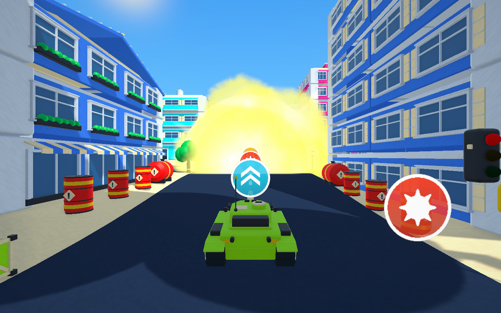
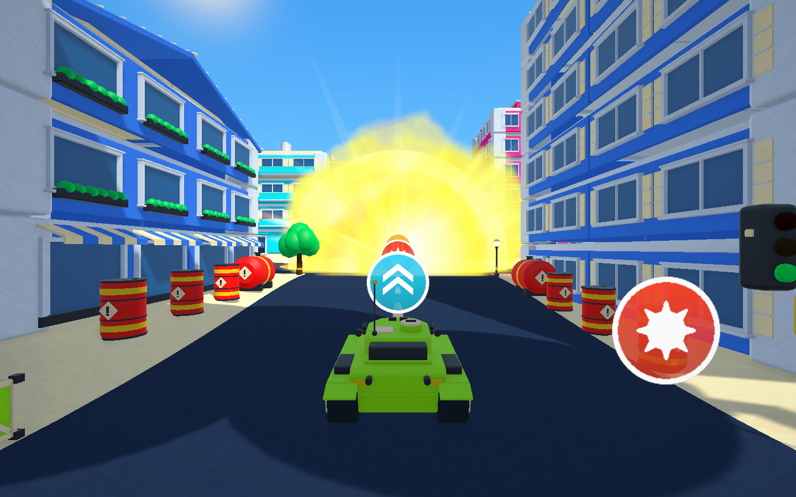
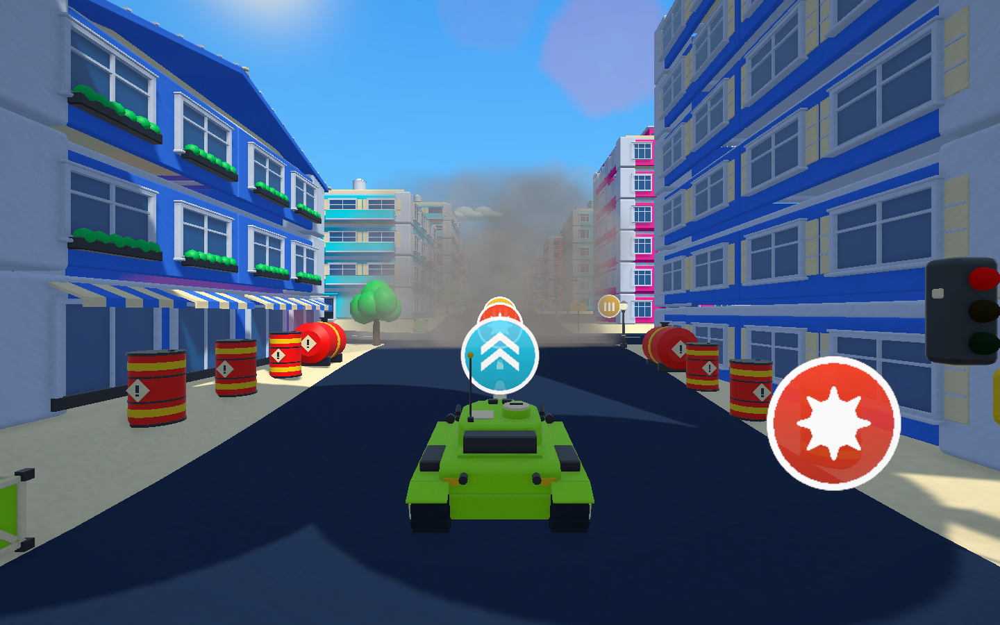
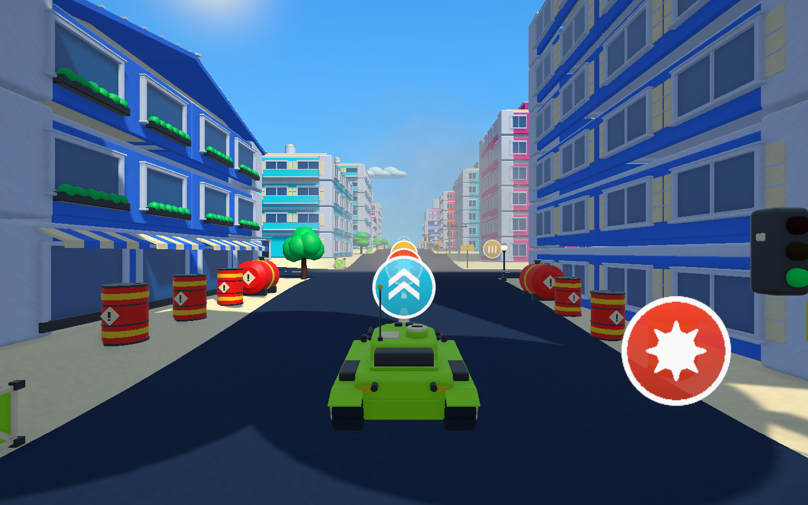
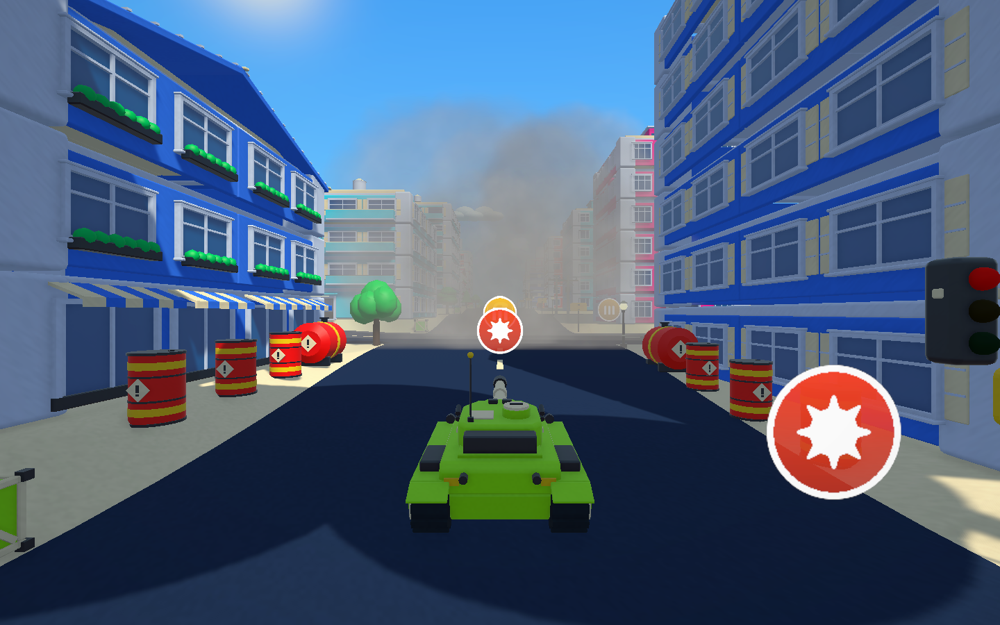
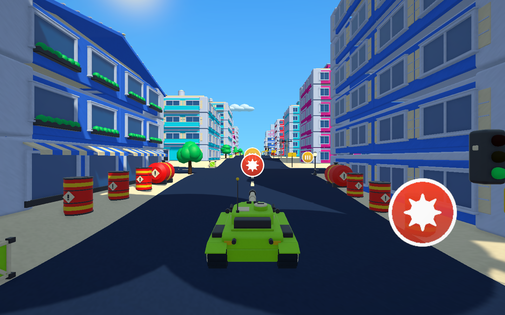

# 爆発を早めに消して次の目標を見やすくする

2026-10-22

遊んだ感想で、爆発の炎と煙が長く残り、次に撃つ建物が見づらいという指摘がありました。爆発の大きさ・明るさ・音・破壊範囲は変えず、表示時間だけを短くしました。

|項目|以前|今回|
|---|---|---|
|炎の粒子の寿命|0.85〜1.65秒|0.5〜1.0秒|
|火花の粒子の寿命|0.8〜1.6秒|0.45〜0.9秒|
|煙の粒子の寿命と開始の遅れ|2.1〜3.05秒、0.45秒後|0.9〜1.5秒、0.25秒後|
|煙の最大の濃さ|52%|44%|
|爆発の表示全体（`BurstLifetime`）|3.8秒|2.0秒|
|閃光・放射状の光・局所光の表示時間|基準の2.4倍|基準の1.4倍|

通常の一発では、光・炎・火花が約1.1秒までに消え、その後の薄い煙も約1.9秒までに透明になります。衝撃波の輪の時間と、爆発の再利用（16組・満杯時0.18秒のフェード）は以前のままです。

同じ位置・同じカメラで撮った、通常の砲撃1発の経過です（PlayMode中に撮影、固定の時間刻み、交通と通行人は停止）。

|経過|以前|今回|
|---|---|---|
|0.3秒|||
|1.4秒|||
|2.0秒|||

## 検証

- 以前の「2.45秒後も残る」ことを確かめていたテスト2件を、「1.1秒後は薄い煙が残り、約2秒で消える」に改めました。閃光が縮まずに消えることを確かめるテストも、短くなった閃光の時間（約0.39秒）に合わせて測る時刻を変えました。
- PlayMode全体の実行で、失敗は変更前から失敗している `TankTownMobilityTests` のレーザー2件と、時刻を直す前の閃光のテストだけでした。直した後、関連する `TankTownVisualPolishTests`・`TankTownPresentationTests`・`TankTownCityKitTests` の16件はすべて成功しています。
- ビルドした実行ファイルの `--tank-town-smoke` と `--tank-town-performance-smoke` は終了コード0です。大量破壊の区間は平均42.6ms・p95 88.2ms（前回の部品入りビルドは49.4ms・93.3ms）でした。単回計測で、街路の区間は回によって14.6〜17.0msとばらつきました。

更新版は `Builds/TankTown-CityKit/TankTown.exe` です（RuntimeアセンブリのSHA-256 `D30A98885FA58EFD51D1439950AA8B7D2C7CFE0A5C81371447C6B4325C0C7EF5`）。手動での操作確認は行っていません。
