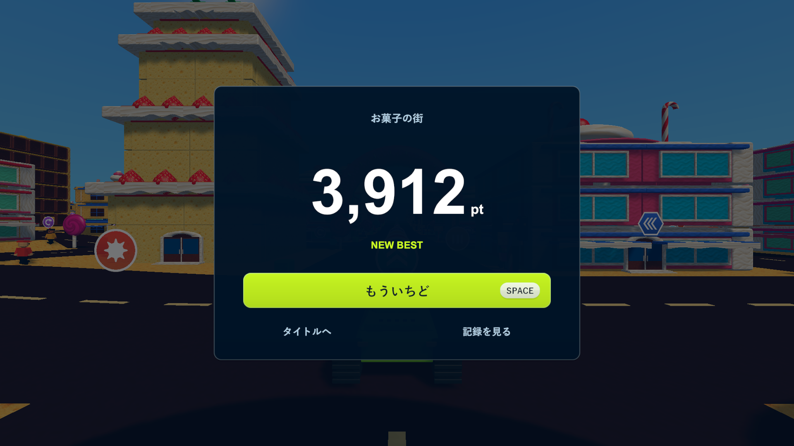
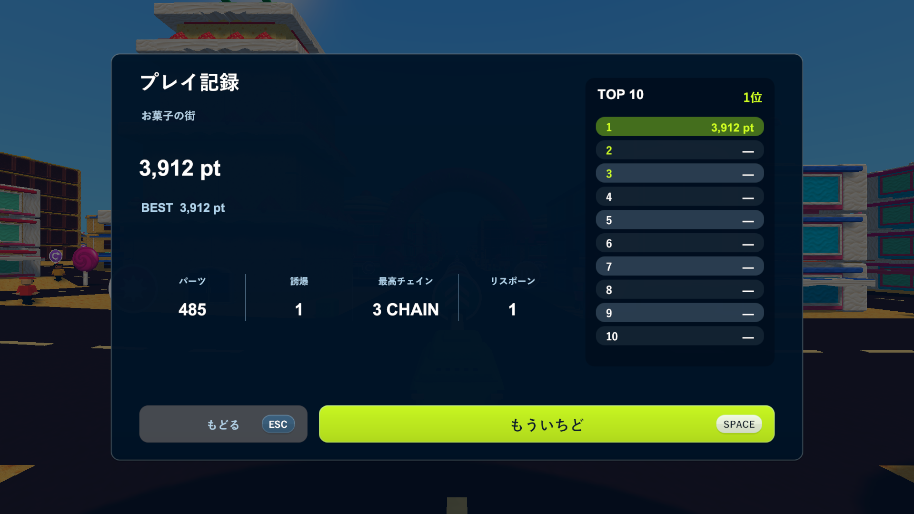

# 今回のptと再挑戦を中心にしたリザルト

2026-10-16。Issue [#27](https://github.com/Negi310/mission2026-game/issues/27)。[以前／現在を切り替える実画面の一覧](menu-redesign-review.html)。

最初のリザルトを中央の800×600のカードへまとめました。ステージ名、今回のpt、NEW BESTまたはベストの1行、大きな「もういちど」、小さな「タイトルへ」「記録を見る」を表示します。評価ランクの円、RESULT見出し、紙吹雪、成績とランキングの常時表示を外し、背景を暗くしました。濃紺・ライム色、細い縁と影、ボタンのホバーは維持しています。

「記録を見る」またはTabで、4種類の成績とTOP 10を別画面に開きます。Escまたは「もどる」で今回のptへ戻れます。記録を開閉しても、スコアや保存件数は変わりません。0.95秒のカウントアップ、端末への記録保存、Spaceによる即再挑戦は維持し、記録画面からもSpaceで再挑戦できます。タイトル・遊び方・プレイ中のHUDの構成は今回変更していません。

## 検証

- Unity 6000.3.19f1でWindows x64 Development Build成功（`Logs/simple-results-build.log`）。
- PlayMode 10/10件成功、34.99秒（`Logs/simple-results-tests.xml`）。既存の開始・遊び方・集計・再挑戦・ステージ・ランキング保存・HUD・再読み込みの確認に、最初は記録が非表示であること、Tab／Escの開閉、数値の維持を追加しました。
- Windows実プレイヤーの診断完了、43画面（`Logs/simple-results-player.log`）。タイトル4ステージ・ホバー6操作・遊び方・開始・実際の破壊・結果・新しい街への再挑戦を確認しています。通常の結果は3,912 pt、破壊パーツ485、誘爆1、最高3チェイン、リスポーン1です。
- 最初のリザルト、記録画面、両方の最大値、遊び方を1920×1080・1280×720・1440×900・1280×1024で確認。文字の収まりと画面各辺24以上の余白を検査しました。キーボードとUIの実際のレイキャストを使って記録を開閉し、保存件数が増えず、記録画面からもSpaceで再挑戦できることを確認しています。
- 最大値の画像はUIの文字だけを100,000 pt・TOP 10の10行・長い成績に差し替える表示検査です。実際のスコアや保存データは変更せず、撮影後に文字を元に戻します。
- Chromeで比較ページの20状態（生成案2枚・Unity実画面18枚）、以前／現在の5つの切り替え、1920・1280・720・390幅での横はみ出し、原寸リンク、JavaScriptエラーがないことを確認（`Logs/simple-results-browser.log`）。これは画像比較ページの検査です。
- レビュー対象と隔離検証プロジェクトのC#・シェーダー91ファイルが改行以外一致（`Logs/simple-results-source-check.json`）。長時間の手動プレイや実機コントローラーでの体感確認は含みません。

更新版は`Builds/TankTown-SimpleResults/TankTown.exe`です。共通の`Builds/TankTown`、`Builds/TankTown-Amusement`、`Builds/TankTown-GameplayUI`も同じプレイヤーに更新しています。GitHubリリースは今回変更していません。

READMEと以前の検証記録・比較ページを更新しました。開発運用に変更はなく、AGENTSやスキルの更新は不要です。

