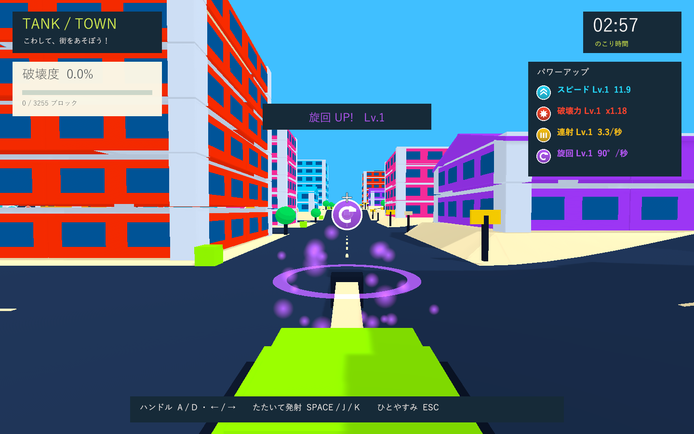

# 坂道の詰まり・上向き砲撃・速度調整の検証

実施日: 2026-10-02。Issue #5 に続く移動と射撃の改善。

## 再現した問題

変更前の実際の地形Colliderを使って、道路の坂、道路脇の上り、道路脇の下りの3経路を走行しました。道路の坂は通過しましたが、道路脇では2経路とも速度0になって停止しました。

- 上り: 公園の南側を `(5, 0, 11)` から東へ進み、約1.41だけ移動した `(6.41, 1.17, 11)` で停止。
- 下り: 同じ場所を `(23, 0, 11)` から西へ進み、約13.32だけ移動した `(9.68, 4.24, 11)` で停止。
- 変更前の再現結果: `Logs/slope-repro-tests.xml`、3件中1件成功・2件失敗。

従来の車体中心の接地判定では、車体の前端・後端と急な地面との接触を処理できませんでした。前回の緩やかな道路だけの走行テストでは、この停止を検出できていませんでした。

## 移動の変更

次の物理ステップの進行先で前後左右の地面の高さを調べ、車体の長さ・幅に沿った傾斜を求めます。姿勢は滑らかに追従し、上限は55度。水平の進行方向は維持します。

続いて車体と同じ寸法・姿勢のBoxCastを実際の地面MeshColliderへ降ろし、車体全体が地面を貫通しない高さを求めます。その高さへ達する上下速度を設定するため、坂の入り口、道路脇、頂上でも車体の端が引っかからなくなります。地面を検出している間は重力を相殺します。

地面の照会は専用の地面レイヤーだけを対象にします。戦車のRigidbodyとColliderは維持しており、建物への衝突、体当たりでの破壊、破片を押しのける動きは引き続き物理衝突で処理します。安全位置の保存は従来どおり30度以下を対象とします。

基本巡航速度は9から11へ約22%上げました。加速度6、車の操舵モデル、スピードアイテムの係数は維持しています。速度8レベルで巡航速度18.04になります。

## 砲身と発射方向

砲身の基部に固定の回転軸を追加し、車体に対して4度上向きにしました。発射位置はその子に置き、砲弾・砲口のエフェクト・HUD照準をすべて砲口のforwardへ揃えています。車体の傾斜と見た目の小さな揺れも砲身の向きに反映します。

`TankTownSettings.asset` の `driveSpeed` と `cannonElevation` で巡航速度と仰角を調整できます。

## Quality Gates

- PlayMode: **29件成功・0件失敗、54.64秒**。XMLは `Logs/slope-final-tests.xml`。
- 道路脇の上り・下り、北西の急な道路と頂上の通過、速度強化8レベルでの斜面通過を確認。実際の走行距離、終点の速度、地面接触による勝手な旋回・爆発がないことを検証しました。
- 平地で砲身の4度の仰角と砲口の方向の一致を確認。実際に生成した砲弾が発射位置より高くなり、その軌道が見た目の砲身の向きと一致することも検証しました。
- 従来の加速・操舵・登坂・車高・破片の押し返し・小物の接触・建物への強い衝突・実砲撃・支持バランス・強化・入力・復帰・ラウンド初期化の回帰テストも成功。
- Windows x64 Development Build: **成功**。ログは `Logs/slope-build.log`。
- formatter/lint専用設定はないため、C#コンパイルとGitの差分チェックを実施。ゲームはネイティブUnityのため、ブラウザに代えてWindowsプレイヤーを画面検証します。

## Windowsプレイヤー

Unity 6000.3.19f1 / URP 17.3.0 / Windows x64 / Direct3D 11 / NVIDIA GeForce GTX 1660 Ti。独立した検証コピーでビルドし、実際のゲームカメラとHUDを1440×900で描画しました。検証用パッケージは同じバージョンのローカルキャッシュを参照し、作業中のUnityやプロジェクト設定は変更していません。

開始・全景・強化取得・砲口・着弾・骨組み・復帰・坂道・結果の9画面を確認。坂道で車体の高さ4.41、実速度11.88、車体に対する砲身の仰角4.00度を記録しています。33棟の倒壊、破片上限280、最終破壊度94.8%も確認しました。

    SMOKE COMPLETE: blocks=3085/3255, crashes=1, state=Results, debrisPeak=280,
    speedLevel=1, powerLevel=1, rapidLevel=1, handlingLevel=4,
    collapsedBuildings=33, parks=3, hillHeight=4.41, hillSpeed=11.88,
    cannonElevation=4.00

ログは `Logs/slope-player.log`。ゲーム例外・シェーダーエラー・C#コンパイルエラーはありません。確認済みのWindows版を `Builds/TankTown/TankTown.exe` へ反映しています。

## 未検証

実時間3分間の手動プレイ、子供の操作感、通常ウィンドウのフレーム時間と音量、実機ハンドル・圧センサー。時間切れは診断機能で早送りし、非表示プレイヤーでは音声出力が無効です。走行は自動前進のアーケードモデルで、WheelColliderを使った車両シミュレーションではありません。
