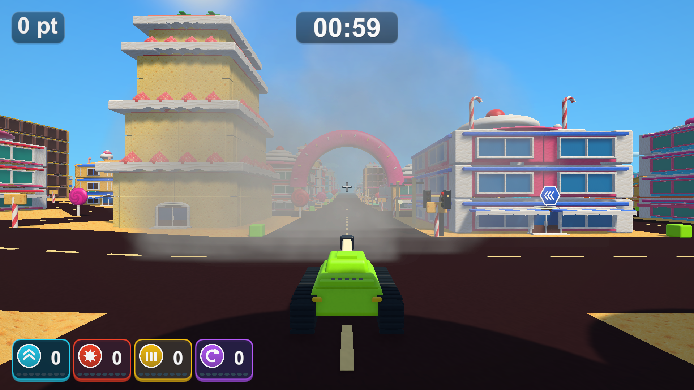

# 煙へつながる消え方と詳細表示の範囲

2026-10-19 / [Issue #39](https://github.com/Negi310/mission2026-game/issues/39)

## 消え方

閃光と放射状の光は、拡大後の形を保ったまま透明度で消します。以前の正弦波による縮小をなくし、透明度は終端の変化が緩やかなSmoothStepで0へ落とします。光の強度45%・延長した表示時間は維持しています。

爆発16組の上限に達した際、表示中の粒子を即座に消して新しい位置へ移す処理もありました。今回は同じ枠を0.18秒でフェードしてから再利用します。新しい閃光・衝撃波はすぐ表示し、混雑時の新しい炎だけが最大0.18秒遅れて出ます。全枠のフェード中にさらに着弾した場合は、その枠の次の位置を最新の着弾へ更新し、フェードの残り時間は延ばしません。追加の枠や無制限の待ち列は作りません。

爆炎と火花を先に消し、灰色の煙の寿命と後半の濃さを増やしました。通常の一発では光・炎・火花が約1.8秒までに終わり、その後は煙だけが残り、約3.8秒までに消えます。爆炎の最大粒子寿命は1.65秒、火花は1.6秒、煙は2.1〜3.05秒で、煙は0.45秒遅れて出ます。煙も最後は透明度0まで落とします。

## 詳細表示

|判定|以前|今回|
|---|---|---|
|簡易表示から詳細へ戻る|建物中心から100m未満|建物の外形を包む範囲から160m未満|
|詳細から簡易表示へ切り替える|建物中心から115m以上|同じ範囲から185m以上|

初期の詳細メッシュのBoundsを使い、カメラを建物のローカル座標へ変換して範囲までの距離を調べます。屋根や大きな飾りも含み、建物中心が遠いだけで手前側を簡略化しません。Boundsは初期形状を保持し、一部を壊しても距離の境界が急に動かないようにします。

160〜185mの間は現在の表示を維持して、境界での往復によるちらつきを防ぎます。遠景の軽いメッシュ、材質ごとの結合、近景だけの再構築、Collider・破壊・地図の更新は維持しています。タイトル専用の背景モデルは対象外です。

## 検証

- Unity 6000.3.19f1のPlayMode関連23件が成功、45.65秒。光が縮まず透明になること、最後が煙だけになること、満杯時の瞬間移動防止・フェード・停止・再利用、詳細距離の拡大と境界の往復、破壊後の描画、既存の表示・性能・お菓子メッシュを含みます。
- Windows x64 Development Build成功。Town・CandyTown・BigCity・AmusementParkの実プレイヤー診断もすべて終了コード0です。71枚を撮影し、各ステージで150mの詳細・190mの簡易表示、煙だけの終盤、爆発の上限・消滅、壁の分離、アイテム終了予告を確認しました。
- C#とシェーダーの変更8ファイルは、検証コピーと改行正規化後一致しています。検証コピー専用のPackages・利用中プロジェクトの設定は変更対象にしていません。

撮影はシード2026・固定時間刻みです。通常画面を撮影後、VFXの確認では交通・爆発物・通行人を非表示にして演出を直接呼び出します。実際の壁への砲撃も別に確認しています。上の写真は約2.5秒後で、画像加工はしていません。

## 負荷の比較

同じPC・D3D11・1920×1080・シード2026・固定した戦車の位置で、前ビルドのSoftFlashと今回のSmokeLodを順に診断しました。実カメラをRenderTextureへ描き、1画素を読み戻して描画完了を待つ方法です。各区間は数秒の単回計測で、通常プレイの継続FPSを保証するものではありません。車や破片の時間進行も完全一致ではありません。

|区間|以前の平均 / p95|今回の平均 / p95|
|---|---|---|
|街路・診断用地図あり|12.8 / 14.9ms|12.0 / 13.5ms|
|街路・地図なし|13.0 / 14.8ms|11.8 / 12.8ms|
|大量破壊・破片最大2,000|32.0 / 83.4ms|34.4 / 66.9ms|

地図なし街路の描画三角形は約622万→705万です。詳細の範囲を広げたため増えています。大量破壊時の最悪フレームは119.8→156.9msでした。通常街路に大きな悪化は見られませんでしたが、大量破壊は引き続き重く、今回の変更を性能改善とはしていません。

## 起動と記録

今回のビルドは `Builds/TankTown-SmokeLod/TankTown.exe` です。通常の `Builds/TankTown`、`Builds/TankTown-Amusement`、`Builds/TankTown-GameplayUI` にも同じビルドを反映し、RuntimeアセンブリのSHA-256一致を確認しました。GitHub Releaseは変更していません。

作業フォルダーの `Logs/smoke-lod-tests.xml`、`smoke-lod-build.log`、`smoke-lod-{town,candy,big,amusement}-player.log`、`smoke-lod-source-check.json`、`smoke-lod-build-hashes.json`、`smoke-lod-performance-{before,after}.{json,log}` に記録を保存しています。README・以前の演出と最適化の記録へ案内を追加しました。開発手順に変更はなく、AGENTS・スキルの更新は不要です。
