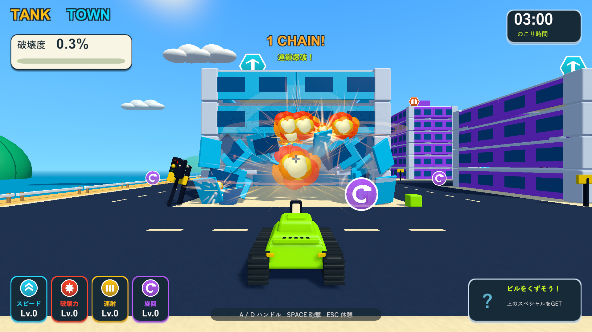
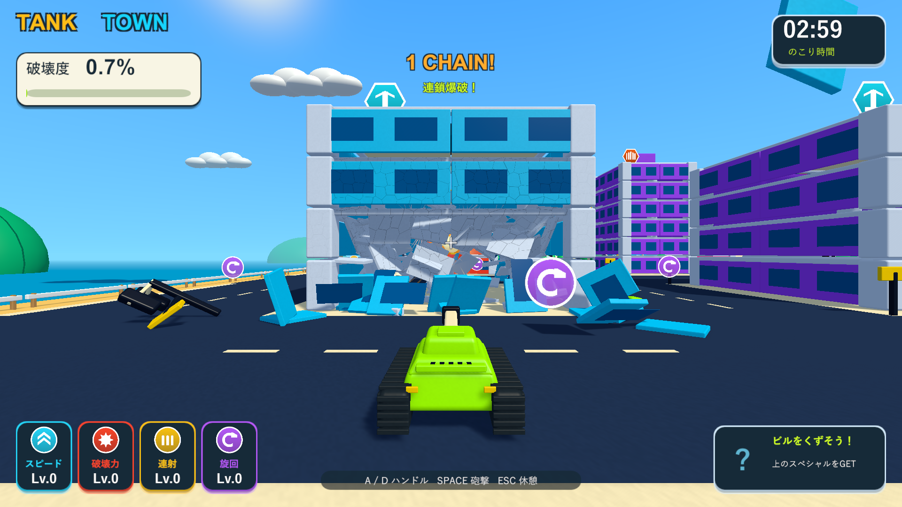

# 局所破壊の量を増やす調整

2026-10-05。関連: [Issue #5](https://github.com/Negi310/mission2026-game/issues/5)。Unity 6000.3.19f1 / URP 17.3.0。

通常砲撃の爆風半径を4から5.5へ広げ、周辺部材への耐久ダメージを1.4倍にしました。直撃した部材に加え、着弾点からCollider表面まで1.25以内の部材を即時に分離します。外側は距離に応じたひびと蓄積ダメージです。近距離の分離範囲も破壊力による爆風範囲の強化に合わせて広がります。

`TankTownSettings`のCannon欄で`blastRadius`・`blastBreakRadius`・`blastDamageMultiplier`を調整できます。破片を飛ばす基準の衝撃力12、周辺部材の耐久力3、支持と重心による倒壊、燃料の点火距離3・大爆発半径24・衝撃力36は継続しています。骨組み全体への一律ダメージは追加していません。

## 検証

| 検証 | 結果 | 記録 |
| --- | --- | --- |
| PlayMode | 90/90成功、106.74秒。実砲撃・局所破壊・柱の支持・ひび・強化・燃料・破片・既存操作とアイテムを確認 | Logs/stronger-local-blast-tests.xml |
| Windows Development Build | 成功 | Logs/stronger-local-blast-build.log |
| 3種類への実砲撃 | 正面1発目は各7部材が分離。3発後も全壊せず、左右の前方支柱を狙って失わせると倒壊・報酬解放 | Logs/stronger-local-blast-durability-player.log |
| 燃料 | 遠い着弾では点火せず、直接砲撃で1個が大爆発。分離済み部材が6から203へ増加 | Logs/stronger-local-blast-fuel-player.log |

| 対象 | 前回の正面1発目 | 今回の正面1発目 | 今回の正面3発後 | 左前の柱を追加で直撃 | 右前の柱も直撃 |
| --- | --- | --- | --- | --- | --- |
| 集合住宅 | 1/81部材 | 7/81部材 | 11/81部材 | 25/81部材・全壊なし | 81/81部材・倒壊 |
| 高層ビル | 1/141部材 | 7/141部材 | 15/141部材 | 24/141部材・全壊なし | 141/141部材・倒壊 |
| 店舗 | 1/62部材 | 7/62部材 | 9/62部材 | 22/62部材・全壊なし | 62/62部材・倒壊 |

同じ位置・高さからの実砲撃で比較しています。分離済み部材数は累計で、物理破片の個数とは異なります。穴を通過した弾は、その建物に新しい命中がなければ損傷を増やしません。診断では走行車と爆発物を無効にし、通常弾と飛散破片による局所破壊を切り分けました。

ネイティブUnityゲームのため、画面検証はWindowsプレイヤーの実描画で行いました。主作業フォルダーとは別の検証コピーを使い、プレイヤーログにゲーム例外・シェーダーエラーがないことを確認しています。これは固定条件の砲撃診断で、3分間の手動プレイ全体の難易度確定は含みません。

確認済みビルドを`Builds/TankTown`と`Builds/TankTown-LocalBlast`へ反映しました。両方のEXE・Runtime DLL・resources.assetsが検証ビルドとSHA256で一致し、125ソース/アセットファイルも作業・検証・レビューの3コピーで一致しています。
