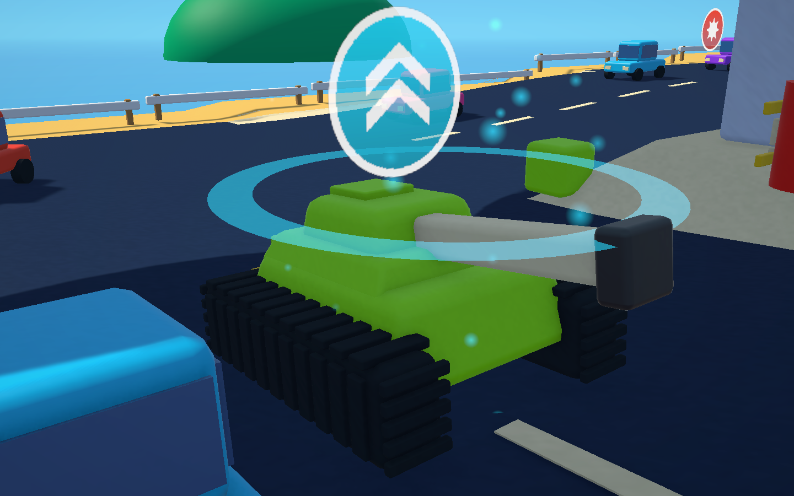
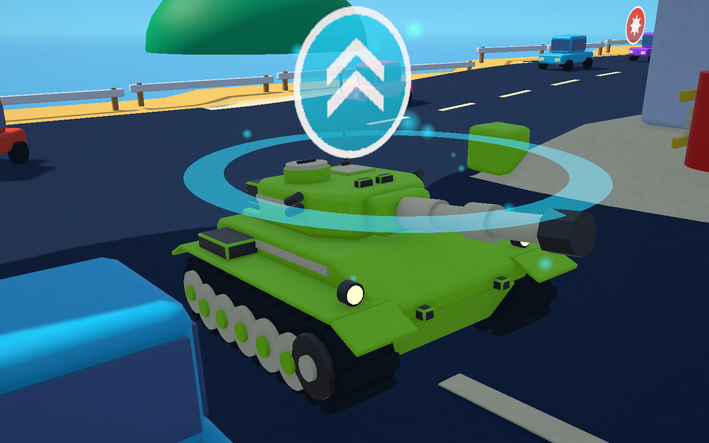
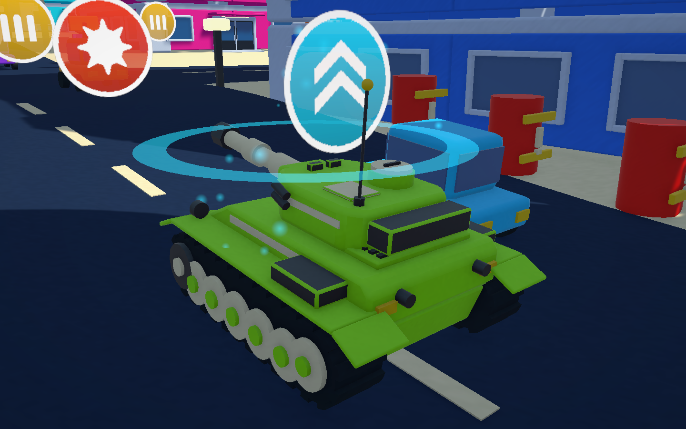
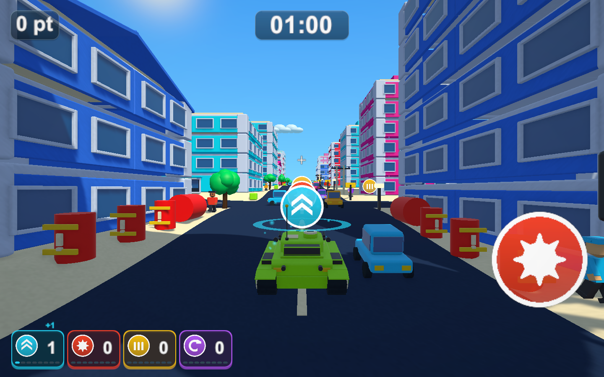
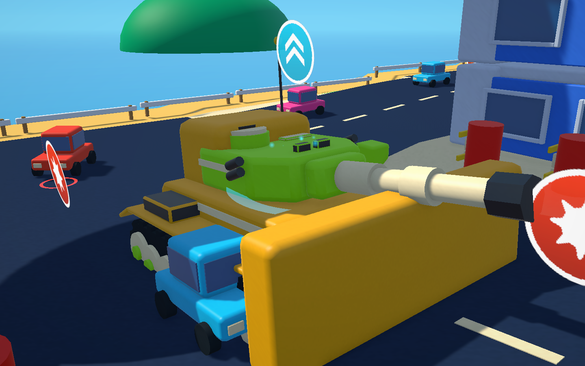

# Blenderで作った戦車モデルへの置き換え（試作）

2026-10-22

## 変更内容

プレイヤー戦車の見た目を、箱の組み合わせからBlenderのスクリプトで作ったモデルへ置き換えました。転輪・起動輪・誘導輪と滑り止めの山がある履帯、前面が傾斜した車体、前すぼまりの砲塔、キューポラとハッチ、アンテナ、発煙弾発射機、排煙器と砲口制退器のある砲身、前照灯・反射板を持ちます。

|変更前|変更後|
|---|---|
|||

- モデルは `scripts/blender/models/player_tank.py` で作り、`-ScriptArguments --assets` で `Assets/TankTown/Resources/Models/PlayerTank.fbx` へ書き出します。
- 部品名と回転軸は従来と同じです。`Tank visual` の下に `Hull`・`Tracks`・`Turret pivot`（0, 0.68, -0.15）→`Turret`、`Fixed cannon pivot`（0, 0.04, 0.55）→`Fixed cannon`、`Shot origin`（砲身の軸から前へ2.8）を持ちます。接地面は当たり判定の底と同じY=-0.8です。当たり判定・走行・砲撃の処理は変えていません。
- `TankTownWorld.CreateTank` がFBXを読み込み、FBXのマテリアルを名前（`TankLime` など）で従来のトイ風マテリアルへ置き換えます。色・光沢・アイテム終了前の点滅は従来と共通です。
- 設定 `importedTankModel` をオフにするか、FBXが読み込めない場合は従来の箱の戦車を作ります。
- 履帯と転輪は車体と別のメッシュ `Tracks` です。ブルドーザー中は車体 `Hull` のライム色の部分だけを黄色にし、前照灯・反射板・黒い部品は元の色を保ちます。終了後は元のマテリアルへ戻します。

## FBXの書き出しと読み込み

BlenderのFBX書き出しの「Apply Transform（bake_space_transform）」は、2階層以上の子（砲塔の下の砲身など）の位置を誤って書き出します。共通処理 `scripts/blender/bkit.py` ではこれを使わず、メッシュと子の位置をFBXの座標系で持ちます。FBXに書かれた各部品の位置・回転を直接読み、回転なし・上記の値どおりであることを確認しました。

Unityの読み込み設定では、アニメーション・カメラ・ライト・ブレンドシェイプの読み込みを切り、Animatorを付けないようにしています。

三角形は約8,200です。描画単位は4メッシュ×マテリアル別の計16で、箱の戦車（約80個の箱）より少なくなります。フレーム時間は測っていません。

## 検証

Unity 6000.3.19f1の独立した検証コピーで実施しました。

- 新規の `TankTownTankModelTests` 2件: 回転軸・弾の出る位置・砲身の仰角、全マテリアルがトイ風シェーダーであること、当たり判定やAnimatorを追加しないこと、大きさと接地面、ブルドーザーの塗り替えと復元。
- 戦車・アイテム・点滅・カメラ・表示・砲弾など関連するPlayMode 70件がすべて成功（160.0秒）。
- PlayMode全体は170件中168件が成功（433.4秒）。失敗は次のレーザー2件だけです。
- `TankTownMobilityTests` のレーザー2件（`LaserCrossesTheCity...`、`LaserReachesWideDistantTargets...`）は失敗します。変更前のコード（HEAD）でも同じ値で失敗するため、今回の変更によるものではありません。
- 画面はPlayMode中にゲームのカメラをテクスチャへ描画して撮影しました（固定の時間刻み）。左右の部品の位置（キューポラは右、アンテナは左後ろ）がBlenderのプレビューと一致し、左右反転していないことを確認しました。

## ビルド

検証コピーで `TankTownSetup.BuildWindows`（Windows x64 Development Build）が成功し、`Builds/TankTown-TankModel/TankTown.exe` へ配置しました。RuntimeアセンブリのSHA-256は検証コピーと一致しています（`8E1F4F678F60FE6D5380F03D5F102DDE911FBB839E972F94F79486C38FC6F450`）。通常の `Builds/TankTown` とGitHub Releaseは変更していません。

- 実プレイヤーの `--tank-town-smoke` は終了コード0で最後まで進み、新しい戦車での走行・砲撃・衝突復帰・坂・結果画面を撮影しました。
- `--tank-town-items-smoke` はブルドーザーの体当たりまで撮影した後、巨大爆弾の撮影で `TankTownSmokeCapture.cs:385` のNullReferenceExceptionにより止まり、終了しません。変更前のビルド（`Builds/TankTown-SmokeLod`）でも同じ行で止まるため、今回の変更によるものではありません。

配布用ビルド（`BuildWindowsRelease`）と手動での操作確認は行っていません。
