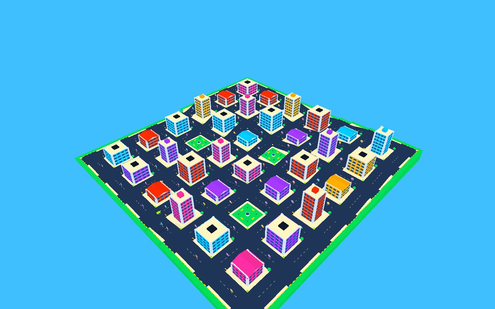
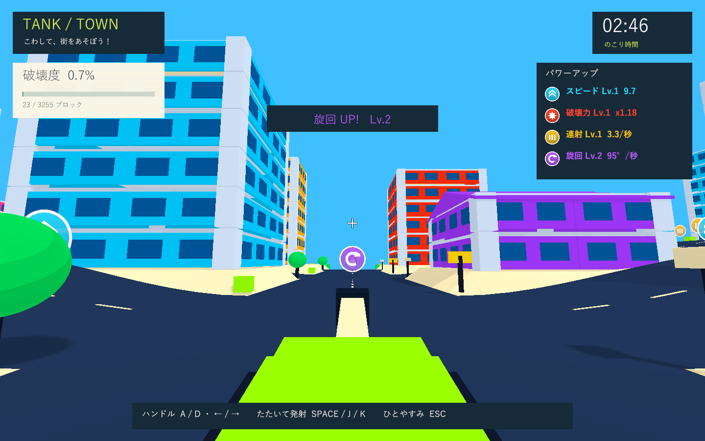

# 高低差・車の挙動・大型エフェクトの検証

実施日: 2026-10-01。Issue #5 に続く操作感・街・演出の改善。

## 環境

Windows / Unity 6000.3.19f1 / URP 17.3.0 / Input System 1.19.0 / UGUI 2.0.0 / Test Framework 1.6.0。独立した検証コピーを使用し、同じバージョンのローカルパッケージキャッシュを参照。元のmanifest、作業中のUnityのプロジェクト設定は変更していません。エディター補助パッケージ全体は検証対象に含めません。

## 車に近づけた動き

前進は自動のまま、基本加速6で巡航速度9へ到達します。ホイールベース3.8、最大操舵角32度、ハンドル応答5を使い、実速度と操舵角のtanから旋回速度を計算します。従来の旋回パラメータと旋回強化も係数として反映します。

曲がる前の横方向の速度を残し、タイヤグリップ7で徐々に抑えます。ハンドルを戻した後も短く旋回が続き、滑らかに直進へ戻ります。見た目の車体には加速時の傾きと旋回時のロールを加えています。

車高は1。専用の地面レイヤーのMeshColliderから高さと法線を取得し、坂道の上下移動と姿勢に反映します。地面に合わせて傾ける際も、進行方向の水平角度は維持します。衝突トルクによる旋回は無効化し、破片を押しのける際も走行中の速度を維持します。保存する安全位置と復帰時の姿勢は30度以下の坂を対象にします。

WheelColliderによる車両シミュレーションではなく、自動前進の操作を維持したアーケード用の運動モデルです。

## 街とカメラ

268×268、道路幅16。低地・丘・高台を滑らかな坂でつなぎ、地面の高さは0〜10.5。交差点と建物の敷地を平坦にし、地形は2刻みの実際のMeshColliderにします。道路・道路の線・建物・小物・アイテムを地面に合わせて配置しました。

33棟のうち、低層店舗は2〜3階と傾斜屋根、集合住宅は4〜6階、高層ビルは6〜8階と細い屋上部分を持ちます。幅は14.4・17.6・20。3つの公園には噴水・ベンチ・木を配置。骨組みと空洞の部屋、支持バランスによる倒壊は維持しています。屋根と屋上設備も支持を失うと物理部材になって落ちます。

カメラは戦車から高さ2.4・後方2.2、視野角72度。直前の高さ1.6・前方0.25から少し引き、砲塔と走行先を見やすくしています。

## 大型エフェクト

標準の演出倍率1.55。火球の直径は直前の約2倍になり、球の房を7→10、通常の火花90→180、伸びる火花65→120、煙28→46へ増やしました。二重の衝撃波を拡大し、16方向へ伸びる放射状の光を加えています。砲口の閃光も拡大しました。

専用のURP火球シェーダーは、カメラに近い表面を透過させます。火球の迫力を保ちながら、近距離で単色の球が画面を埋める状態を避けます。シェーダーは実際のWindowsプレイヤーの描画で確認しました。

## Quality Gates

- PlayMode: **24件成功・0件失敗、32.53秒**。XMLは `Logs/terrain-tests.xml`。
- 加速と操舵の慣性、ハンドルの滑らかな戻り、実際の坂道の上昇・姿勢・車高、斜めの地面での進行方向の維持を追加検証。
- 高台の敷地・柱の足元・アイテムの高さ、地面Collider、幅・階数・公園の変化を確認。高台の小物への移動テストも地面の高さに対応させました。低い噴水には実際の形に合わせた凸MeshColliderを用い、体当たりによる分離と押し返しも確認しています。
- 従来の入力・実砲撃・破壊・支持バランス・小物接触・破片による旋回防止・強化・復帰・停止・結果・初期化の回帰テストも成功。
- formatter/lint専用設定はないため別のツールを導入せず、C#コンパイルとGitの差分チェックで確認しました。
- Windows x64 Development Buildと実プレイヤーの画面確認: **成功**。ログは `Logs/terrain-build.log` / `Logs/terrain-player.log`。ゲームはネイティブUnityのため、ブラウザに代えて実行ファイルを検証します。

## 実プレイヤーでの検証

Direct3D 11 / NVIDIA GeForce GTX 1660 Ti。非表示のWindowsプレイヤーの実際のゲームカメラとHUDを1440×900で描画しています。開始・全景・アイテム取得・砲口・着弾・骨組み・復帰・坂道・結果の9画面で、日本語UIと効果を確認しました。

各棟の片側二本の基礎柱を分離し、実際のPhysX更新を伴う33棟の倒壊を連続実行。破片の最大280個、破壊度94.8%、部材3085/3255、復帰1回。坂道を走る車体の高さは4.16で、開始した道路の高さ1から上昇しています。骨組みの画面では診断のため外壁を直接分離しています。

    SMOKE COMPLETE: blocks=3085/3255, crashes=1, state=Results, debrisPeak=280,
    speedLevel=1, powerLevel=1, rapidLevel=1, handlingLevel=2,
    collapsedBuildings=33, parks=3, hillHeight=4.16

ゲームの例外・シェーダーエラー・C#コンパイルエラーは実行ログにありません。

## 実画面

## 未検証

実時間3分間の手動プレイ、子供の操作感、通常ウィンドウのフレーム時間とスピーカーの音量、実機ハンドル・圧センサー。非表示のスモークでは音声出力が無効で、時間切れを早送りします。支持バランスは簡易モデルで、実建築の荷重限界や曲げを解析しません。
