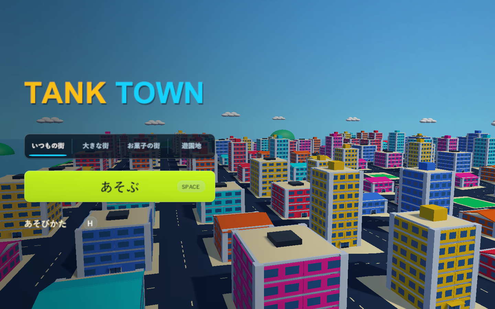
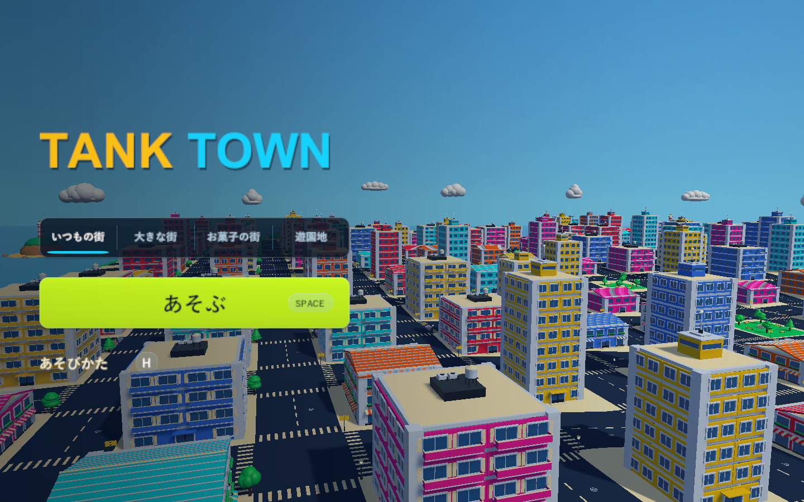
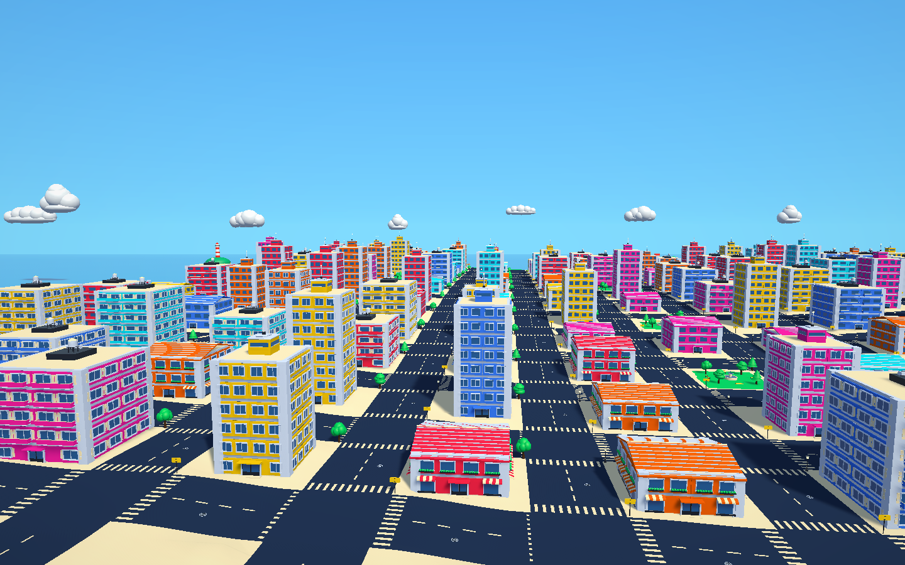

# タイトル背景を新しい大きな街の風景にする

2026-10-23

## 変更内容

タイトル画面の背景（大型街の軽い表示用モデル、`TownTitlePreview`）に、遊ぶ街と同じBlenderの部品を使うようにしました。以前は箱だけで組んだ建物と、遊ぶ街から写した雲・島でした（新しい島は名前が変わったため写っていませんでした）。

|変更前|変更後|
|---|---|
|||

- 全ての建物: 集合住宅のバルコニー、高層ビルの頂部の飾り、屋上の室外機と給水タンク、商店の瓦の筋。
- 道路: 横断歩道・マンホール・丸い破線（遊ぶ街と同じ配置）。
- 街角と公園: 区画ごとの木・街灯・標識と、公園の噴水・ベンチ・木。軽さを保つため木箱は置いていません。
- 島・帆船・雲: 遊ぶ街と同じ配置を大型街の広さで置きます（雲は動かない背景のまま）。
- 窓: カメラから230m以内の建物だけ部品の窓（店先と日よけを含む）にし、250mより遠ざかると以前の軽いガラスの窓に戻します。最初のフレームで近くの建物をまとめて作り、その後は1フレームに1棟ずつ作ります。

背景の物は従来どおり描画専用で、当たり判定・壊れる部材・スクリプトはありません。全てタイトル用のレイヤーに置きます。設定 `importedCityModels` をオフにすると以前の背景になります。

## 負荷

背景の描画中のメッシュの三角形（カメラの範囲外も含む合計）は約44万→約132万で、部品の窓が付いた建物は29棟でした。PlayMode中の測定で、シーンを読み込んでタイトルが出るまでは箱の背景2.64秒・部品の背景1.92秒でしたが、1回目は読み込みの準備を含むため比べられません。

実プレイヤーの `--tank-town-performance-smoke`（シード2026・1920×1080・同じPC、各区間は数秒の単回計測）のタイトル区間です。描画三角形は影を描く分も含みます。

|ビルド|平均 / p95|描画三角形|描画呼び出し|
|---|---|---|---|
|道路・雲・遠景まで（背景は箱）|7.2 / 9.3ms|158万|2,506|
|背景に部品（窓にも影）|8.3 / 9.2〜9.3ms|472万|3,197〜3,200|
|背景に部品（窓の影なし、今回）|7.9〜8.3 / 9.6〜9.8ms|393〜396万|3,002〜3,010|

窓の影は正面の壁にほとんど見えないため、背景の窓だけ影を描かないようにしました。タイトルの1フレームは約1ms増えましたが、60fps（16.7ms）に対して十分な余裕があります。遊ぶ街の区間は変わりません。

検証コピーで `TankTownSetup.BuildWindows`（Windows x64 Development Build）が成功し、`Builds/TankTown-TitleKit/TankTown.exe` へ配置しました。道路・雲・遠景の変更も含みます。RuntimeアセンブリのSHA-256は `82754F25AFBDBEC295FFB47B7D074ECD1EB4E1E4B103A789F156A9E52CDA4541` で、検証コピーと一致しています。実プレイヤーの `--tank-town-smoke` と `--tank-town-performance-smoke` は終了コード0です。

## 検証

- `TankTownCityKitTests` に1件追加: 背景に街の小物と遠景があること、全建物に軽い窓があり部品の窓はカメラの近くの一部だけであること、カメラが遠ざかると全て軽い窓に戻ること、当たり判定がなく全てタイトル用のレイヤーにあること。設定をオフにした背景に部品がないことも確認します。
- PlayMode全体は175件中172件が成功（617.9秒）。失敗は以前からのレーザー2件と、`TankTownGenerationTests.NormalRetryGeneratesANewCityAndOneMinuteEndsTheRound`（再挑戦の最初のフレームで残り時間が59.44秒になり、59.5秒以上の確認に届かなかった）です。後者はPCの負荷で揺れるテストとして[PR #48](https://github.com/Negi310/mission2026-game/pull/48)で直しているもので、再挑戦ではタイトル背景を作り直しません。同じテストのクラスだけを実行し直すと6件すべて成功しました。
- 背景の窓の影をなくした後、`TankTownCityKitTests`・`TankTownRoundFlowTests`・`TankTownGenerationTests` の17件がすべて成功しました。
- 画面はPlayMode中にゲームのカメラをテクスチャへ描画して撮影しました。手動での操作確認は行っていません。
