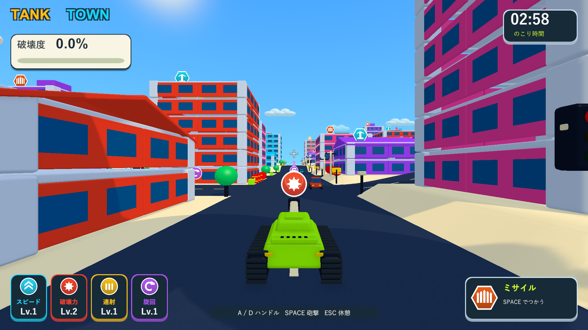

# 編集イメージを反映した街・モデル・UI・爆発

2026-10-04。Issue #5 の演出・UI改善の追加実装。Unity 6000.3.19f1 / URP 17.3.0。

元のゲーム画面から作成した [完成イメージ案](../output/imagegen/tank-town-gameplay-concept-v1.png) を基準に、実際に遊べる画面へ反映した。画像案のスコアやアイテム状態を固定表示せず、ラウンド中の実データを表示する。

## 変更

|対象|実装|
|---|---|
|通常HUD|破壊度を左上、時計を右上、4種類の能力を左下、スペシャルを右下へ配置。能力の詳細な内部数値をレベル表示へ変更。角丸カード、色付きの枠と影、太い表示用フォント、大きな破壊度の数値を追加。|
|通知|連鎖は上部の短い大文字表示と日本語の説明。取得通知は左上へ移動。復帰・外周の案内を残し、砲撃の狙いと道路を覆う大きな帯を廃止。|
|スペシャル|所持武器のアイコン・発動操作と、発動中の効果・残り時間を分けて表示。最大4効果の文字が余白内に収まる高さへ調整。未取得時は疑問符と建物から取得する案内。|
|タイトル・停止・結果|タイトルのロゴをオレンジとシアンで統一。開始ボタン・説明カード・結果カードを角丸に変更し、操作ボタンと本文を太くした。停止・結果の幕は画面全体を覆う。|
|戦車|車体・砲塔の上部が狭まる斜面と小さな丸み。上部装甲、ハッチ、エンジンの通気口、反射板、履帯の上面・側面・前後の踏板を追加。物理コライダーは従来の寸法を維持。|
|街のモデル|柱・梁・床・外壁・車・小物に寸法に応じた丸みを追加。共通メッシュをキャッシュして再利用。室内の空洞と既存の部材接続・物理崩壊を維持。|
|陰影|連続した面の陰影、暖色のハイライト、寒色の柔らかい影、窓の光沢、控えめな路面の粒状感を追加。URPの接地影を受ける法線パスとSSAO対応を追加。|
|描画設定|ゲーム専用のURPコピーに影の距離95m・MSAA 4倍を設定し、終了時に元へ復元。ユーザーのURPアセットを変更しない。Windowsの初期サイズを1600×900に設定。|
|街の構成|車18台のうち1つの周回路を開始道路にも通す配置へ変更。車線の破線を太く長くした。|
|アイテムの見通し|丸い通常アイコンを小さくし、六角形のスペシャルとの区別を維持。カメラから4～8mの範囲では滑らかに透過させ、カメラを通り抜けるアイコンが戦車を隠す問題を解消。|
|爆発|外側のオレンジ、内側の黄色、明るいクリーム色の中心を持つ19個の立体的な膨らみ。形と大きさに変化を付け、面の陰影と光沢で球体の厚みを表現。急な縮小を廃止し、膨らんでから滑らかに消える1.05秒の演出へ変更。火花・放射状の光・地面の衝撃波を維持し、煙を明るい暖色に変更。カメラの振動やFOV変更を追加しない。|

## 検証

検証コピー: `C:/Users/fsato/.codex/visualizations/2026/09/26/01a0db20-34c9-7523-9137-15bff5a2e20c/tanktown-visual-validation-20261004`。既存の隔離コピーのローカルPackageCache参照を再利用し、メインのパッケージ・Unity設定とGitインデックスを維持した。

|実行|結果|記録|
|---|---|---|
|PlayMode全体|63/63成功、106.81秒|`Logs/toy-visual-final-tests.xml`|
|実画面後のHUD・交通・カメラ|14/14成功、16.24秒|`Logs/toy-visual-polish-tests.xml`|
|斜面付きモデルの物理寸法・HUD|3/3成功、5.28秒|`Logs/toy-visual-model-tests.xml`|
|4効果の同時表示・文字の収まり|3/3成功、2.79秒|`Logs/toy-visual-ui-final-tests.xml`|
|Windows Development Build|ビルド成功、終了コード0|`Logs/toy-visual-final-build.log`|
|Windowsの通常画面・実砲撃|13画面を確認、終了コード0|`Logs/toy-visual-final-player.log`|
|Windowsの交通・連鎖・落下アイテム|13画面を確認、終了コード0|`Logs/toy-city-final-player.log`|

追加した3ケースは、道路と狙いの領域をHUDが覆わないこと、実際の強化・所持武器・効果の残り時間が表示へ反映されること、描画メッシュの変更で戦車と建物のコライダーが変わらず物理分離できることを確認する。同時に4効果を発動して、全名称が表示され、フォントの必要高さと文字枠がパネル内に収まることも確認した。

最初の全体検証では、爆発のMaterialPropertyBlockをMonoBehaviourのフィールド初期化で作成したため15件が例外で失敗。Awakeへ移し、全体を再実行して63件成功を確認した。

画面はWindows Development BuildをD3D11で起動し、実カメラとHUDをRenderTextureへ描画して保存する。`--tank-town-toy-smoke` はタイトル・通常走行・ミサイル・複数効果・実砲撃・連鎖・倒壊・破片・停止・結果の13画面を出力する。1920×1080、1280×720、1440×900を含む。戦車の位置と向きを狙いやすい場所に固定し、車1台を直接の砲撃範囲外・燃料の爆風範囲内へ配置する。能力とスペシャルは診断用に付与する。破壊は実砲弾と通常の爆風・支持喪失・物理演算を使用する。3分間の手動プレイや実機コントローラーの体感確認は含まない。

ネイティブUnityゲームのため、画面確認にはブラウザではなくWindowsプレイヤーを使用する。

最終ビルドの実砲撃では、3502パーツ中164パーツの破壊から結果画面への遷移を確認した。街の診断では、車18台・信号17基、砲撃から車2台の誘爆、最高2段の連鎖、上階スペシャルの落下・接地・実接触での回収、2.000秒のメガビーム、181パーツの破壊を確認した。両実行にゲーム例外・シェーダーエラーはない。

街の診断は1440×900で起動して同じサイズへ撮影する。異なる縦横比で起動して1440×900へ直接描画すると診断画像のHUDが切れるため、起動サイズを揃えて再確認した。通常プレイのHUDは前述の3解像度で確認済み。

検証した実行ファイルとデータを `Builds/TankTown` に配置し、隔離コピーと配置先の `TankTown.Runtime.dll` のSHA-256が一致することを確認した。旧キャプチャとユーザーのUnity設定は維持した。

## 実装後の画面

