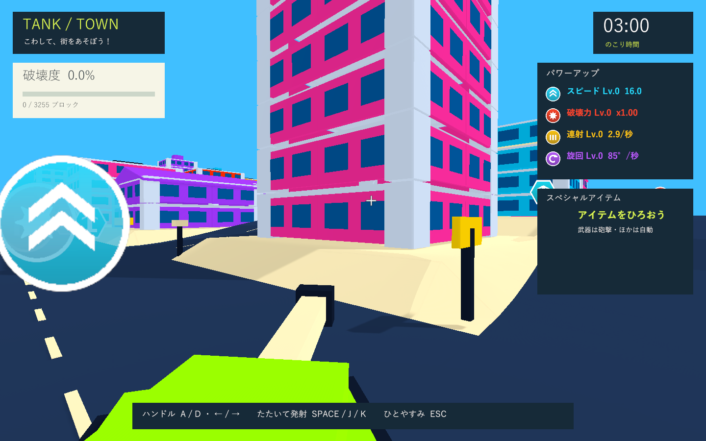

# 砲塔カメラと車体の追従強化

実施日: 2026-10-02。カメラの向きを砲塔に戻し、砲塔と車体の向きの差を抑えて反応を速めました。

|設定|変更前|現在|
|---|---|---|
|車体の旋回開始の遅延|0.2秒|0.08秒|
|車体の操舵応答|5|12|
|砲塔の最大先行角|38度|22度|

砲塔が先に向く動きは維持します。旋回開始とハンドルを戻した後の直進復帰を速め、走行中に向きが大きく離れすぎないようにしています。カメラは車体後方の位置から砲塔の向きへ滑らかに追従。復帰時のSnapも砲塔方向を使います。カメラの高さ・距離、巡航速度16、加速度10、旋回速度85度/秒、地面追従、圧入力とアイテムの効果は維持します。

## 検証

全39件を実行し、38件が成功。残り1件はカメラの方向を砲塔軸から0.2度以内とする仮定が厳しく、実測0.381度で失敗しました。車体後方2.2から砲塔方向の70先を見るための視差です。仮定を1度以内へ修正し、その1件の再実行が成功しました（1.78秒）。車体に向くカメラでは8度以上の差が出る条件で、砲塔への追従を確認しています。全39件の実行後はゲーム処理を変更せず、テストの視差の許容のみ修正しています。

回帰38件では、実際の坂・道路脇・頂上・下り、加速と横慣性、ハンドルを戻した後の旋回停止、小物と破片の衝突、支持と重心による倒壊、圧入力、6種類のアイテム、効果の自然終了・停止・結果と復帰を確認しました。XMLは `Logs/turret-follow-tests.xml`。

関連テストでは砲塔が先に動き、その時点でカメラが砲塔を向くこと、約0.24秒で車体が8度以上旋回すること、実際の砲弾が砲塔の方向へ飛ぶこと、通常追従中のカメラ、ハンドルを戻して0.3秒以内の旋回停止を検証します。XMLは `Logs/turret-follow-focus-tests.xml`。

Windows x64 Development Buildが成功。Direct3D 11 / GTX 1660 Tiの実プレイヤーを `--tank-town-camera-smoke` で動かし、砲塔先行・車体旋回・直進復帰の3画面を確認しました。

|診断項目|実測|
|---|---|
|旋回開始直後の砲塔先行角 / 車体角|12.60度 / 0.00度|
|旋回開始直後のカメラと砲塔の差|0.39度|
|継続旋回中のカメラと砲塔の差|4.12度|
|継続旋回中のカメラと車体の差|17.88度|
|約0.45秒後の車体旋回量|31.28度|
|ハンドルを戻した後のカメラと車体の差|0.00度|
|衝突爆発|0回|

設定値0.08秒 / 12 / 22度を実プレイヤーのログでも確認。関連テスト・ビルド・実プレイヤーの最終ログにゲーム例外・C#コンパイル・シェーダーエラーはありません。診断ログは `Logs/turret-follow-player.log`、画像は `Builds/TankTown/Captures/turret-camera-01-lead.png`、`turret-camera-02-follow.png`、`turret-camera-03-centered.png`。

検証済みWindows版を `Builds/TankTown` に配置し、検証コピーとのRuntime DLLのSHA-256一致を確認しました: `30C363BA89362EE40EC1DF6205A5372B3CF1AFCEB459173C801A9458A6F1B048`。

Unity 6000.3.19f1 / URP 17.3.0。独立した検証コピーを使用。画面検証はネイティブWindowsプレイヤーを対象とします。formatter/lint専用設定はなく、コンパイルとGit差分チェックを実施しました。数値は試作の調整値で、手動プレイでの操作感・実機入力は未検証です。
