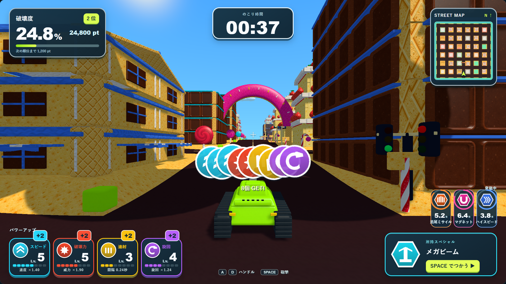
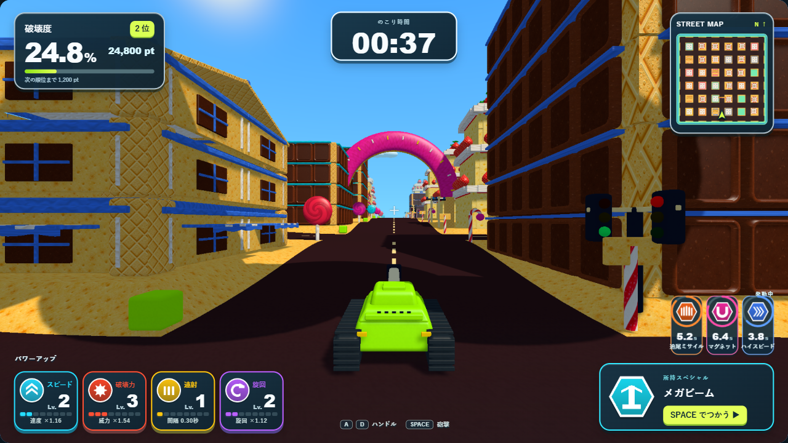

# プレイ画面UIの更新案

2026-10-10。今回ゲームへ反映したのは、取得アイコンを同じ一列に重ねる変更です。このページと[操作できる画面見本](ui-proposal/preview.html)は、次のHUD更新の提案です。見本の数字は演出確認用で、UnityのHUDへはまだ反映していません。

## 方針

取得した場所、上がった能力、持っている武器、発動中の効果を、同じ色とアイコンでつなぎます。短い取得演出を戦車の近くに置き、継続して見たい情報は画面の下へ固定します。

現状は、取得の文章が最後の種類へ上書きされ、左下のレベルが即座に切り替わります。右下の大きなアイコンは所持品と発動中の効果で切り替わり、残り時間は別の文字一覧です。新案では以下のようにします。

|場所|表示と役割|変化の見せ方|
|---|---|---|
|戦車のすぐ上|取得したアイコンを同じ一列に重ねる|フィールドから0.14秒で移動。新しいものを手前へ。取得の勢いを見せる|
|左下|4色のパワーアップ。大きいLv数字と8段階の小ゲージ|数字が0.16秒で上下に切り替わり、ゲージが1段埋まる。枠が弾み「+1」「+2」を出す|
|右下|所持スペシャル専用の大きな六角形|アイコン・名前・Spaceの使用表示。取得時に短く拡大。満杯時はこの枠を光らせる|
|所持枠のすぐ上|発動中の効果を小さな六角形で同時表示|円ゲージが減り、残り秒数を併記。終了間際だけ小さく脈動し、終了で消える|
|左上|破壊度・得点・順位を1枚へまとめる|順位を小バッジにし、常時表示する文章を短くする|
|上中央 / 右上|残り時間 / ミニマップ|固定位置を保ち、中央の照準と建物を空ける|

## 取得を見逃さない演出

複数種類を一緒に取った場合は、対応する左下の枠がそれぞれ反応します。文章を最後の1種類へ上書きする代わりに、種類ごとの「+2」と増えたレベルを同時に見せます。戦車上では「8個 GET!」のような短いまとめ表示を添えます。

同じ種類を連続取得したときも、新しい目標レベルへ数字が追いつきます。能力そのものは取得時点で反映し、表示のアニメーション待ちでゲームの性能を遅らせません。到着・数字の変化・小さな上昇音のタイミングをそろえる案です。音は今回のHTML見本には含めていません。

丸いアイコンと六角形は、現在フィールドで使っている画像をそのまま使用します。強化とスペシャルの違いを形でも維持します。

## 所持と発動中を分けて理解できるようにする

メガビームとギガント爆弾は「持っていて、砲撃入力で使う武器」として大きい枠へ置きます。追尾ミサイル・マグネット・ブルドーザー・ハイスピードは取得時に発動するので、時間付きの小さい枠へ直接追加します。レーザー使用中も、ミサイルやマグネットの時間が同時に読めます。

空の所持枠は控えめな六角形と「ビルを全壊でゲット」。武器が使えるときはSpaceを明るく表示し、別の武器がまだ発動中なら待機表示へ変えます。既存の発動条件を変更する案ではありません。

再取得による効果時間の更新では、円を満タンへ戻し、実際に増えた秒数を短く出します。現在のゲームは残り時間を設定時間へ戻す方式なので、例えばマグネットの6.4秒→8秒は「+1.6秒」です。毎回8秒を加算する表示にはしません。

ギガント爆弾は接触で爆発するため、固定の効果タイマーとして見せず、飛んでいる間は「飛行中」、命中で消す表示にします。

## 操作見本と検証

[HTMLを開く](ui-proposal/preview.html)と、強化取得・8個のまとめ取得・スペシャル取得・Space発動・マグネット再取得・時間経過・爆弾着弾を試せます。ゲーム画面と、4種類の強化・6種類のスペシャル・ミニマップの画像は、今回のWindowsプレイヤーから取得しています。外部の画像やフォント配信は使わず、ファイルを開くだけで動きます。

ChromeとPlaywrightで、画像の読み込み、数字のアニメーション、8個以上の一列表示、所持と発動中の同時表示、武器待機と待機解除、実際に増えた時間、終了による消去、爆弾の状態、1920×1080と1280×720の配置を確認しました。ログは`Logs/ui-proposal-browser.log`、任意の確認スクリプトは[verify-preview.cjs](ui-proposal/verify-preview.cjs)です。

