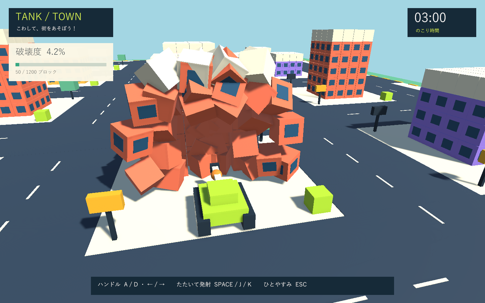

# 初回プロトタイプの検証

実施日: 2026-09-26

## 環境

- Windows / Unity 6000.3.19f1。
- 開いている作業用Unityとは別の検証コピーを使用。
- 検証コピーでは Input System 1.19.0、URP 17.3.0、UGUI 2.0.0、Test Framework 1.6.0 とその依存パッケージを使用。初回のパッケージ取得の遅延を避けるため、同じバージョンのローカルキャッシュを参照。
- 元プロジェクトの `Packages/manifest.json` は変更していません。エディター補助用パッケージを含めた構成全体の検証とは区別します。

## PlayMode

7件成功、失敗0件。実行時間8.17秒。

|テスト|確認内容|
|---|---|
|AutoDriveAndSteeringMoveTank|自動前進とハンドル相当の旋回|
|BlastReleasesSupportsAndScoresOnlyOnce|爆風、支持を失った上部のRigidbody化、二重加点防止|
|PressureNeedsReleaseAndTracksPadsIndependently|打撃の解除・再入力、左右の独立性、クールタイム|
|CrashPenalizesOnceAndRespawns|1回だけのペナルティ、安全地点への復帰|
|PauseAndTimeoutFreezeGameplayAndRestartResetsCity|停止、時間切れ後の加点禁止、街・残り時間の初期化|
|RealShellHitsBuildingAndCrushablePropsBreakOnContact|実際の砲弾の命中と、小物への物理接触|
|SolidBuildingCollisionTriggersRespawn|大型建物への強い衝突による爆発|

## 残る確認事項

- 実機ハンドル・圧センサーの通信、キャリブレーション、遅延と誤入力。
- 子供が触ったときの速度、旋回、連打、ペナルティの調整。
- 目標PCでの長時間プレイとフレーム時間測定。
- 実際のスピーカーでの音量と効果音の確認。検証環境では音声デバイスが利用できませんでした。
- 建築の支持判定は縦の柱ごとの簡易モデル。横方向の梁・荷重計算は未実装。

ブラウザ製品ではないため、画面検証はUnityのWindowsプレイヤーを対象とします。

## Windowsビルド・画面

- Windows x64 Development Build: 成功。
- 実行ログ: `SMOKE COMPLETE: blocks=50/1200, crashes=1, state=Results`。
- 開始、砲撃による崩落、復帰待ち、結果の4画面を1440×900で確認。日本語表示、破壊度、時間、画面ボタンに見切れなし。
- 非表示ウィンドウではバックバッファのキャプチャが黒くなるため、検証用の `--tank-town-smoke` はSRPの描画要求で実カメラをRenderTextureへ描画し、HUDを一時的にScreen Space Cameraへ変更して撮影します。通常プレイはScreen Space Overlayのままです。通常ウィンドウでの手動操作と音声の体感確認は別途必要です。
- スモーク実行は結果画面への遷移を早送りして検証。3分間の実時間耐久試験ではありません。

