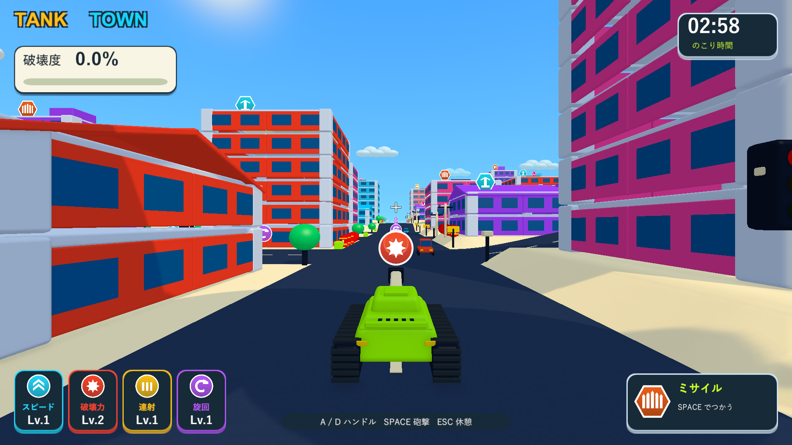
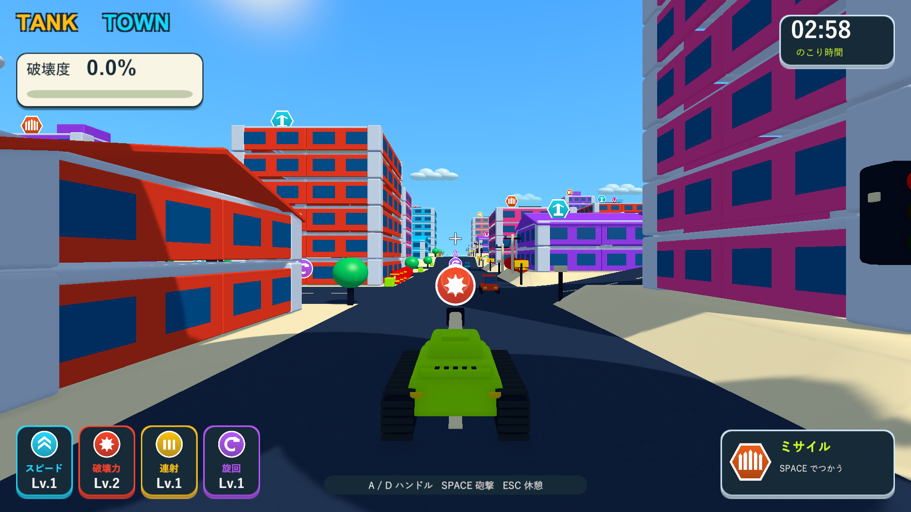
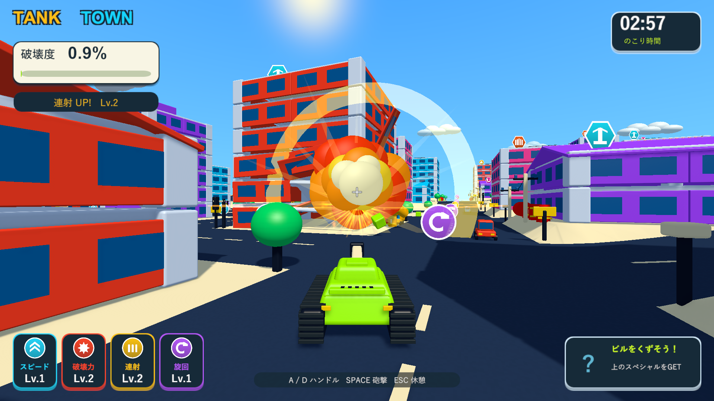
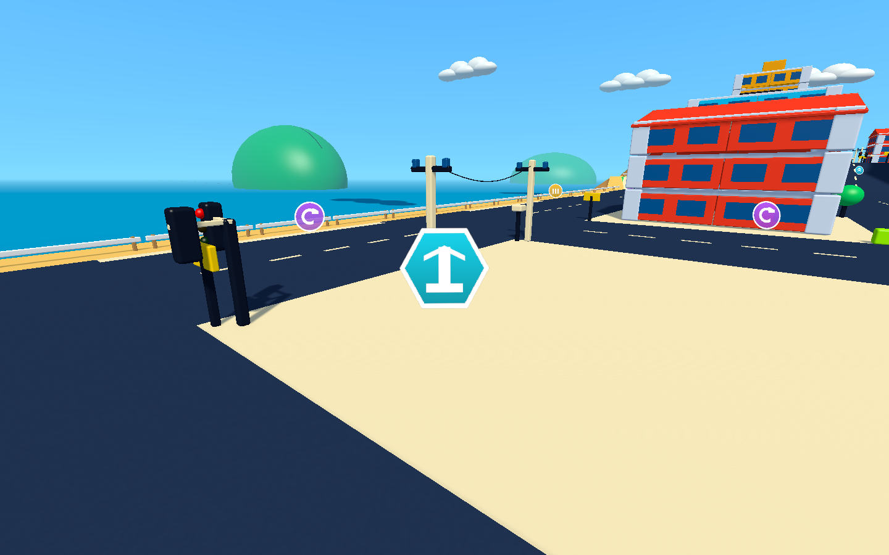

# 光と影・破壊後の視認性

2026-10-04。Issue #5 の表示調整。Unity 6000.3.19f1 / URP 17.3.0。

日なたと影の差を強め、連続砲撃のあとに道路・戦車・次の標的が見えるよう、爆発と破片の余韻を短くした。

## 変更

|対象|以前|調整後|
|---|---|---|
|陰影|面全体を明るくする塗りと薄い影|寒色の控えめな環境光と、太陽の色・強度を受ける直接光を分離。日なたと陰の差を拡大|
|太陽|強度1.6・影の強さ0.85|強度1.75・影の強さ1.0。柔らかい影を維持|
|角の光沢|共通の強さ0.18|0.26。窓・道路・履帯の個別設定を維持|
|立体的な爆炎|1.05秒、0.5秒から薄くなる|0.6秒、0.2秒から薄くなる。膨らみと最大サイズを維持|
|通常の爆発の煙|最大1.5秒|最大0.65秒|
|倒壊の粉じん|最大1.3秒|最大0.5秒|
|ギガント爆弾の煙|最大2.4秒|最大0.9秒|
|通常の衝撃波|0.6秒|0.35秒。大爆発は1.2秒から0.5秒へ短縮|
|破片|9秒で削除|2.4秒で削除。最後の0.45秒で描画と影を薄くする|

破片の表示はマテリアルを複製せず、専用の表示率をMaterialPropertyBlockへ設定する。カメラの遮蔽物透過とは別の値を使い、既存の透過・色を維持する。色・深度・法線・影のパスで同じ消失を反映する。更新処理は分離した破片にだけ追加し、無傷の街の部材に毎フレーム処理を追加しない。

破片は消えるまで従来のRigidbodyとColliderで飛散する。消えても破壊度と建物の破壊済み部材数は減らない。誘爆する車・燃料は0.18秒の導火線を完了させる。時間停止中は爆風の経過、破片のフェードと寿命も止まる。

## 検証

メインのUnity設定・パッケージ・Gitインデックスを維持し、既存の隔離コピーでPlayModeとWindows Development Buildを検証する。ネイティブUnityゲームのため、画面検証はブラウザではなくWindowsプレイヤーを使用する。

追加したケースは、破片の消失がカメラ透過を上書きしないこと、停止中に進まないこと、削除後もスコアを維持すること、通常とギガント爆弾の爆炎・煙・衝撃波が短時間で消えることを確認する。

初回は65件中64件成功。既存の砲塔追従ケースのカメラ角度チェックが失敗した。物理ステップと描画フレームの進み方を比較するケースなので、アイテム検証の時間を60fpsの描画ステップへ固定し、終了時に元へ戻すようにした。新しい消失検証は初回から成功している。

|実行|結果|記録|
|---|---|---|
|PlayMode全体の再検証|65/65成功、85.37秒|`Logs/visibility-final-tests.xml`|
|Windows Development Build|ビルド成功、終了コード0|`Logs/visibility-build.log`|
|Windowsの通常HUD・実砲撃・倒壊|終了コード0、実砲撃で169/3502パーツを破壊|`Logs/visibility-toy-player.log`|
|Windowsの誘爆・落下報酬|終了コード0、車2台の誘爆・最高2段連鎖・落下と回収成功|`Logs/visibility-city-player.log`|

実画面は通常のカメラとHUDを用い、1920×1080・1280×720・1440×900で確認した。破壊は実砲弾・通常の爆風・支持喪失・Rigidbodyで発生させる。診断では戦車と車の配置・強化・所持アイテムを設定している。落下報酬の接地画面は診断用カメラで撮影し、支持を追加で外す操作を含む。3分間の手動プレイとフレーム性能の測定は含まない。プレイヤーログにゲーム例外・シェーダーエラーはない。

検証したビルドを `Builds/TankTown` に配置し、実行ファイルと `TankTown.Runtime.dll` が隔離コピーと一致することをSHA-256で確認した。

## 実画面

