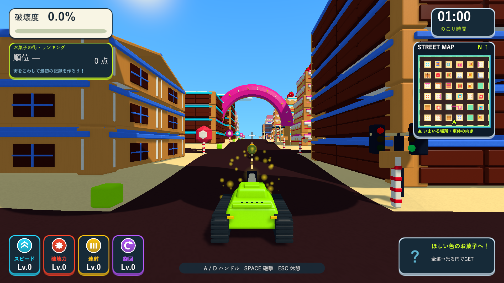
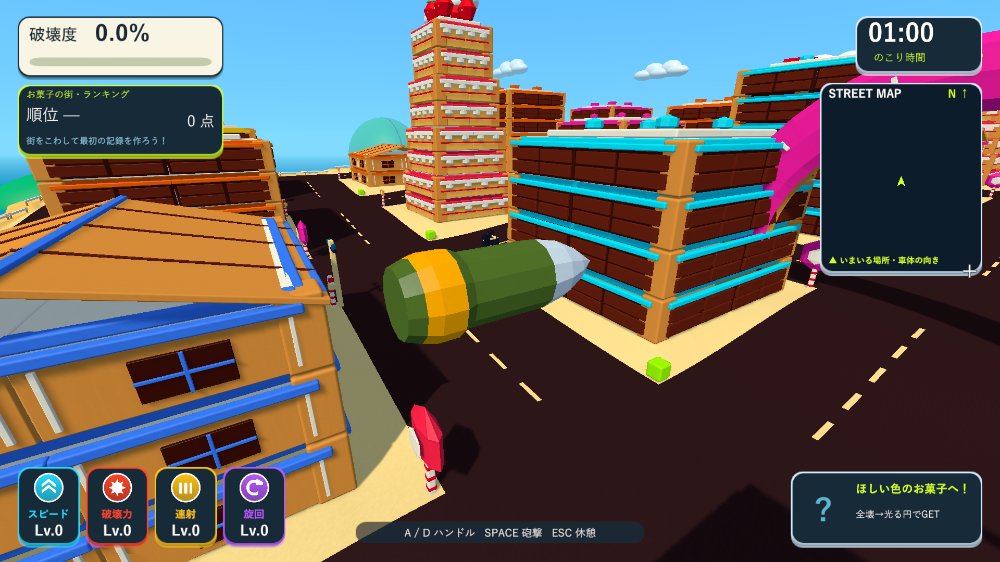
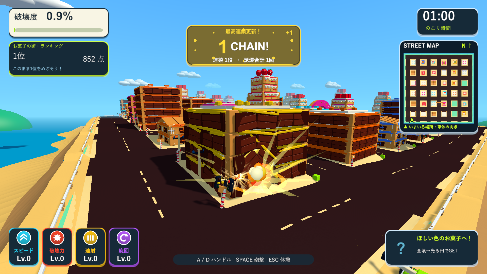

# 砲弾の表示サイズ拡大

2026-10-09。Issue #5。

砲弾の表示サイズを縦・横とも3倍にしました。長さは1.25から3.75、最大直径は0.46から1.38です。既存の銀色の先端・緑の弾体・金色の帯の共有モデルを拡大し、通常のプレイカメラで弾体を見つけやすくしています。`TankTownSettings.shellVisualScale`で表示倍率を調整できます。

弾速120、半径0.25のSphereCast、爆風・破壊力・射撃間隔は維持しています。表示倍率はRendererのTransformへ適用し、命中処理は従来どおりワールド座標の移動区間と固定半径で計算します。共有メッシュと3種類の共有材質をそのまま使用するため、頂点数や描画回数は増えません。

分離したUnity 6000.3.19f1プロジェクトで、既存の砲弾3件とお菓子の街4件のPlayModeテストが7/7件成功しました（`Logs/visible-shell-tests.xml`）。実射の弾速・方向・ポーズ、20fps相当で薄い壁に命中すること、通常砲撃による部分破壊を確認しました。

Windows x64 Development Buildは`Logs/visible-shell-build.log`で成功しました。Skillのブラウザ確認に相当する画面確認を、D3D11のWindowsプレイヤーの実描画で行いました。`Logs/visible-shell-player.log`はexit 0で完了し、実測弾速120.0、表示倍率3.0、着弾0.167秒、チョコの建物の部分破壊を確認しました。通常のプレイカメラでの実飛行と、診断用カメラでのモデル詳細・着弾を1920×1080で保存しました。診断では戦車を固定し、ランキングは保存しません。

検証済みビルドを`Builds/TankTown-FastShell`、`Builds/TankTown`、`Builds/TankTown-LocalBlast`へ反映し、各配布先の実行ファイル・Runtime DLL・resources.assetsのSHA-256の一致を確認しました。

- Runtime DLL：`DF60E4E03370793DAEA3152CCD8A706992C208A823D7CC9A2A1FCEF2D5723CFD`
- resources.assets：`C5F185C08F9F771E15873D9B1FED3262A86DDCCE1794CE8F45DEC72C0E187CBF`

