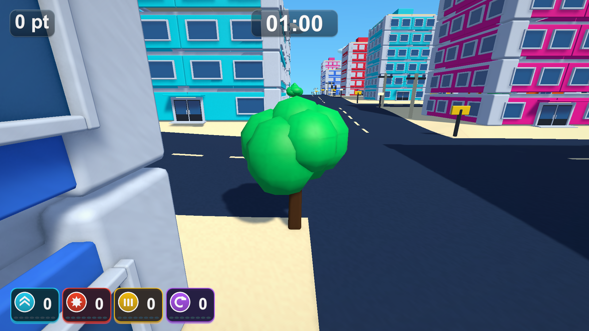
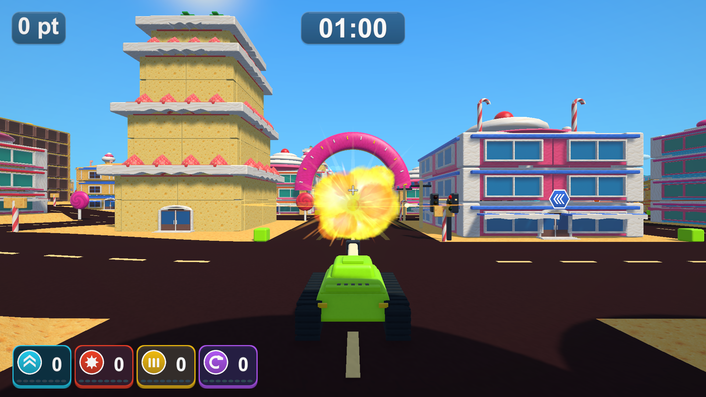

# 光・素材・造形・爆発とアイテム終了予告

2026-10-19 / [Issue #31](https://github.com/Negi310/mission2026-game/issues/31)

追記：爆発の範囲と持続は[追加調整](expanded-explosion-validation.md)で拡大しました。以下の爆発時間・写真・検証結果は初回実装時の記録です。現在は基準サイズ1.8倍・最大約2.4秒です。

[実画面の比較ビューアー](visual-polish-review.html)で、お菓子・大型街・遊園地、木、材質、爆発の各段階、終了予告を切り替えられます。画像はWindowsプレイヤーからのキャプチャです。

## 実装

- 暖かい日差しと青みのある環境光、接地の陰影を強め、影の偏りを調整しました。ガラス・塗装・金属に空の反射とハイライトを加えています。元の配色を保ち、チョコや飴のツヤ、スポンジやウエハースのマットな質感、柔らかいクリームを描き分けます。
- 控えめなHDRブルームと街灯・入口の発光を追加。爆発の閃光は周囲の壁・地面・戦車を短く照らします。局所照明は最大4か所の共有シェーダー処理で、PointLightや追加の影マップを生成しません。色調補正は中立に固定します。
- 通常建物の窓に空洞のある立体枠、屋上に縁を追加。お菓子の店にも厚みのある窓枠・桟・暗いガラスを追加しました。窓枠は元の壁の破片に追従し、静的結合と破壊後の描画切り替えに対応します。
- 木は枝付きの幹と房状の樹冠に変更。形の違う3種類の共有メッシュと頂点色による色むらを使います。各木に個別メッシュやRigidbodyを追加せず、幹と樹冠の複合当たり判定を維持します。
- 19個の球を生成する火球を、専用の密度テクスチャ・シェーダーとParticleSystemによる爆炎・煙・火花へ置き換えました。明るい中心から外側の炎へ変わり、0.16秒遅れて煙が広がり、約1.1秒で晴れます。煙は光による濃淡と地面付近のソフトな透過を持ちます。画面揺れは加えません。
- ブルドーザー・マグネット・ハイスピードは残り3秒から毎秒約2.4回の点滅で終了を知らせます。ブルドーザーは履帯・砲塔・ブレードを含む車体全体を明るい色へ切り替え、立体の陰影を残します。マグネットは磁場の輪、ハイスピードはシールドと軌跡を点滅させます。能力と当たり判定は点滅中も有効です。一時停止では停止し、再取得で通常表示に戻り、効果終了・自爆・ラウンド終了で表示を解除します。

爆発の3層は最大16組を再利用します。各組は爆炎32・煙18・火花36粒子を上限とし、補助の光・衝撃波・一般粒子は最大64オブジェクトです。粒子に物理演算や衝突判定は追加しません。密度テクスチャ2枚と各マテリアルは共有し、終了時に破棄します。VFX Graphの依存は追加していません。

## 検証

Unity 6000.3.19f1の専用コピーで検証しました。利用中の作業フォルダーや他プロジェクトのEditorは操作していません。

|確認|結果|
|---|---|
|PlayMode：表示・アイテム・性能・木の接触・カメラの関連テスト|41 / 41成功、89.97秒|
|最終の煙調整後：今回追加した3テストを再実行|3 / 3成功、16.88秒|
|Windows x64 Development Build|成功|
|最終ビルドの実プレイヤー診断|Town・CandyTown・BigCity・AmusementParkすべて終了コード0|
|実画面|4ステージ計59枚。比較ページには現在10枚・以前1枚を採用|
|比較ページのChrome / Playwright確認|10画面の画像読込、以前との切替、4画面幅、原寸リンク、JavaScriptエラーなし|
|検証コピーとのソース照合|264ファイルを照合。C#・シェーダー・asmdefの111ファイルは改行正規化後一致、シェーダー9個を含む|

ソース照合では、テクスチャのmeta 10個の行末空白と、既存マテリアルへUnityが明記したシェーダー既定値だけを許容しています。追加された値がすべてソースのシェーダー既定値と一致することも確認しています。検証コピー専用のPackages設定はコミットしていません。

PlayModeでは車体全体の同時点滅、3効果の能力維持、一時停止、再取得、解除、40発同時生成時の上限、光・粒子の消滅と再利用、共有樹冠、破壊した壁への窓枠の追従を確認しました。既存のカメラ・アイテム・性能テストも成功しています。

実プレイヤーはシード2026・固定時間刻みで撮影しています。通常のプレイ画面を撮った後、近景とVFXを確認するため車・爆発物・通行人を非表示にしています。能力強化と報酬アイコンも非表示です。終了予告は診断用に3効果を4秒で直接付与しています。爆発の段階写真はVFX単体を呼び出し、別途、実際の壁への砲撃・破片への分離も確認しています。画像加工はしていません。以前の画面とは解像度・戦車や交通の位置・アイテム表示条件が異なります。

各ステージの診断では、16組の爆発再利用、最大4局所光、消滅、3種類の点滅、一時停止、再取得、解除、実際の壁の破壊を確認します。爆発の消滅確認は無敵体当たりが起きるアイテム付与より前に行い、別の衝突による爆発を混在させません。

この確認は自動テストと実プレイヤーの固定シナリオです。長時間の手動プレイ、実機コントローラー、GPU負荷や継続FPSの測定は含みません。ブラウザーで動かしたのは比較ページで、Unityゲームではありません。

## 起動と記録

ローカルの `Builds/TankTown-VisualPolish/TankTown.exe` が今回のビルドです。通常の起動先 `Builds/TankTown`、`Builds/TankTown-Amusement`、`Builds/TankTown-GameplayUI` にも同じビルドを反映し、4フォルダーの `TankTown.Runtime.dll` のSHA-256一致を確認しました。既存のGitHub Release v0.1.1は今回更新していません。

作業フォルダーの `Logs` に次の検証記録を保存しています。ビルドやログ本体はGit管理対象外です。

- `visual-polish-final-tests.xml` / `visual-polish-delivery-tests.xml`
- `visual-polish-delivery-build.log`
- `visual-polish-delivery-{town,candy,big,amusement}-player.log`
- `visual-polish-source-check.json` / `visual-polish-build-hashes.json`
- `visual-polish-browser.log`

README・アイテム仕様・本記録を更新しました。開発手順に変更はなく、AGENTS・スキルの更新は不要です。
