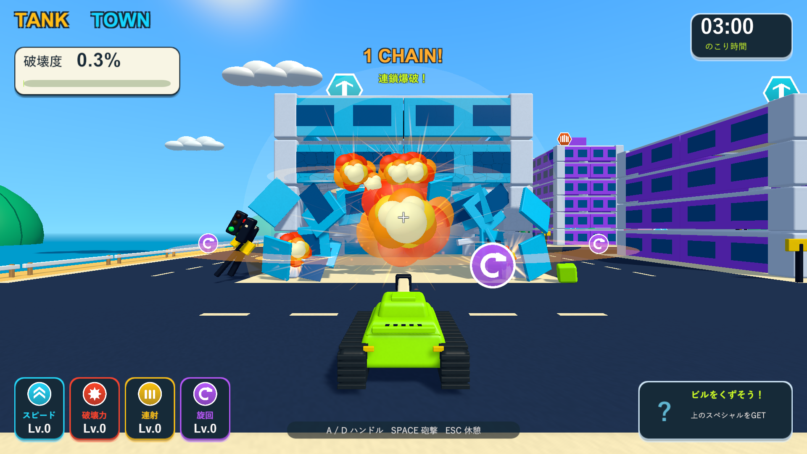
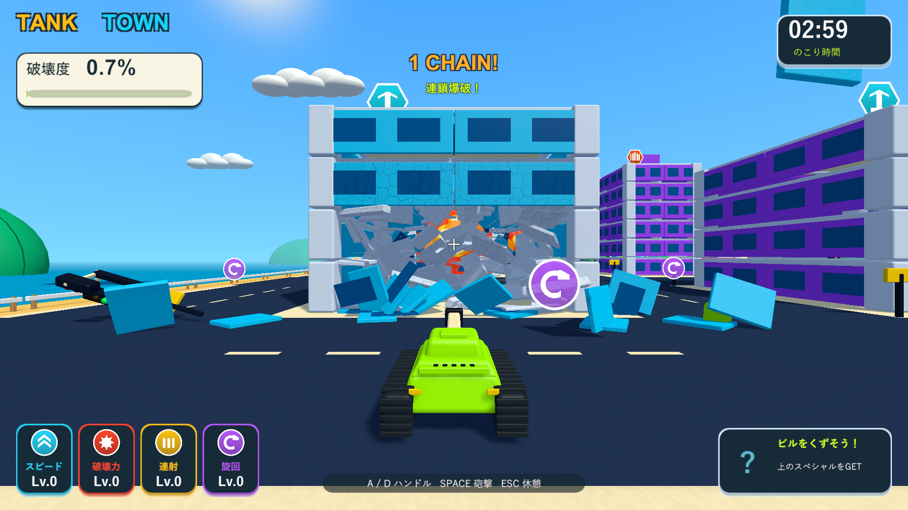

# 爆風範囲と威力の追加強化

2026-10-05。関連: [Issue #5](https://github.com/Negi310/mission2026-game/issues/5)。Unity 6000.3.19f1 / URP 17.3.0。

通常砲撃の爆風半径を5.5から8、着弾点に近い部材を即時分離する範囲を1.25から3へ広げました。周辺部材への耐久ダメージ倍率は1.4から2.4で、前回の約1.71倍です。外側の距離減衰とひび、直撃1発の破壊、支持と重心に応じた倒壊を保持します。連射で周辺の骨組みも削れます。

破片を飛ばす基準の衝撃力12、部材の耐久力3、燃料の点火距離3・大爆発半径24・衝撃力36は継続しています。砲撃回数による倒壊のロックや、離れた骨組みへの一律ダメージは追加していません。連射で支持が失われた場合の倒壊も検証で許容し、最初の通常砲撃が局所破壊になることを確認します。

| 検証 | 結果 | 記録 |
| --- | --- | --- |
| PlayMode | 90/90成功、109.65秒。実砲撃・局所破壊・支持喪失・強化・ひび・燃料・破片・既存操作とアイテムを確認 | Logs/wider-local-blast-tests.xml |
| Windows Development Build | 成功 | Logs/wider-local-blast-build.log |
| 3種類への実砲撃 | 最初は部分破壊。正面への連射で周辺も損傷し、前方の支柱を失うと倒壊・報酬解放 | Logs/wider-local-blast-durability-player.log |
| 燃料 | 遠い着弾では点火せず、直接砲撃で1個が大爆発。分離済み部材が20から195へ増加 | Logs/wider-local-blast-fuel-player.log |

| 対象 | 前回の正面1発目 | 今回の正面1発目 | 今回の正面3発後 | 左前の柱を追加で直撃 | 右前の柱も直撃 |
| --- | --- | --- | --- | --- | --- |
| 集合住宅 | 7/81部材 | 9/81部材 | 12/81部材 | 30/81部材・全壊なし | 81/81部材・倒壊 |
| 高層ビル | 7/141部材 | 7/141部材 | 19/141部材 | 30/141部材・全壊なし | 141/141部材・倒壊 |
| 店舗 | 7/62部材 | 12/62部材 | 14/62部材 | 34/62部材・全壊なし | 62/62部材・倒壊 |

同じ位置・高さからの実砲撃で比較しています。部材数は分離済みの累計で、物理破片の個数ではありません。高層ビルの前方支柱は、正面1発後の耐久率が前回0.828から今回0.577へ低下しました。即時に分離する部材数が同じ場合も、外側へ伝わる損傷は増えています。できた穴を通った弾は、その建物に新しく命中しなければ損傷を増やしません。

ネイティブUnityゲームのため、画面はWindowsプレイヤーの実描画で確認しました。砲撃診断では戦車の位置・高さを固定し、走行車と爆発物を無効にしています。3分間の手動プレイ全体の難易度確定は含みません。プレイヤーログにゲーム例外・シェーダーエラーはありません。

確認済みビルドを`Builds/TankTown`と`Builds/TankTown-LocalBlast`へ反映しました。両方のEXE・Runtime DLL・resources.assetsが検証ビルドとSHA256で一致し、125ソース/アセットファイルも作業・検証・レビューの3コピーで一致しています。
