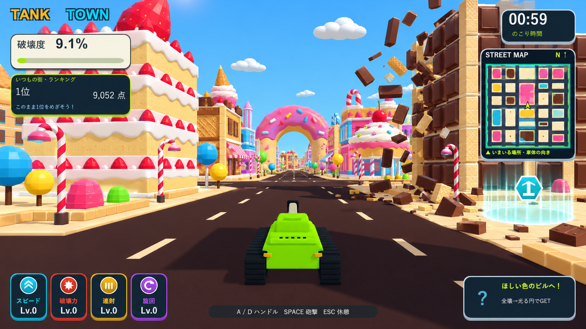
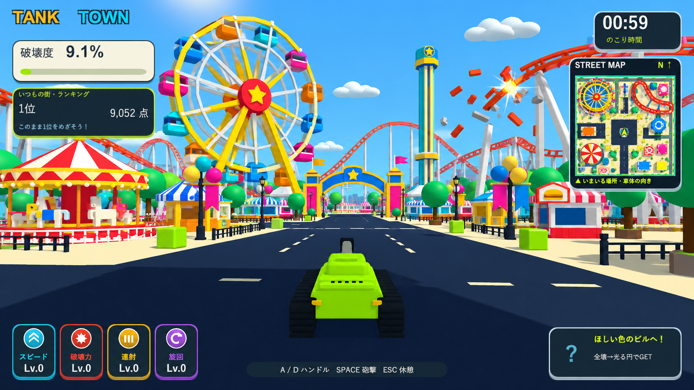

# ステージのコンセプト画像

2026-10-08。内蔵 image_gen により生成した構想画像。実装済みのUnity画面ではありません。

実画面の戦車・UI・ローポリ表現・彩度・影を参考に、お菓子の街と遊園地を制作しました。

参照画像：
- D:/GitHub/mission2026-game/docs/images/tank-town-beam-camera-04-restored.png
- D:/GitHub/mission2026-game/docs/images/tank-town-strong-reward-area-big.png

## お菓子の街



### 使用プロンプト

```text
Use case: stylized-concept.
Create one landscape 16:9 GAMEPLAY SCREEN CONCEPT for the existing Unity tank destruction game, using the two attached real game screenshots as visual references.
Image 1 is the primary composition / tank / HUD reference; image 2 is the secondary reference for the current saturated toy-like buildings, shadows, clear sky, and simple material style.
Keep the same low-poly lime green tank in the lower center, looking forward along a wide traversable street, with the same recognizable hull, black tracks and fixed barrel. Match the grounded third-person play camera of image 1, not an aerial view. The world should look achievable in this Unity game: simple beveled geometric modules, chunky silhouettes, clean flat colors, restrained texture, strong sunlight and dark crisp shadows, high saturation, cheerful blue sky with a few simple soft toy clouds. Preserve the existing Japanese HUD arrangement, TANK TOWN logo, top-right 00:59 timer and STREET MAP frame, left destruction/score panels, four bottom-left upgrade cards, crosshair, and lower-right special item card. Keep the UI compact as in the reference and do not add decorative concept art labels. You may omit the temporary top-center chain announcement so the stage landmarks remain visible. Update the miniature map artwork to broadly match the new environment.
This is a proposed stage visual, not a real captured build. Replace the city architecture with the requested new environment, while maintaining the current game's graphic language. Avoid photorealism, realistic food photography, cinematic depth of field, painterly illustration, excessively intricate models, branded mascots, extra vehicles replacing the tank, or white-out explosion effects that hide the stage.
Stage: お菓子の街 / candy town.
Build an unmistakably edible-looking but geometric toy candy town around the tank's road. A tall layered strawberry shortcake building with pale sponge block floors, white icing trim and a large faceted strawberry on its roof stands on the left. On the right, a tall chocolate-bar building uses a readable grid of chunky breakable chocolate squares, supported by wafer-colored columns. Nearby are modest wafer-and-biscuit houses and a colorful cupcake-shaped pavilion. Farther along the road is a huge pink-frosted doughnut arch landmark visible through the street corridor. Add a few striped candy-cane lampposts, colorful round lollipop trees, gumdrop shrubs, and ice-cream-cone roof silhouettes. Keep large open driving lanes and distinct building footprints rather than filling every surface with tiny sweets. The road is deep cocoa / navy-brown with cream lane dashes, surrounded by pale biscuit pavement, preserving the road readability of the original. Use strawberry pink, chocolate brown, cream, cyan and lemon yellow, with sufficiently vivid colors to match the game.
Show one localized recently shattered chocolate facade in the midground, with a small scattering of rectangular chocolate and wafer fragments suspended and on the ground, making the physical breakability clear while leaving most of the town intact. Preserve an open view to the landmarks and the green tank. One cyan glowing circular reward zone with its small floating hexagonal item icon may appear off to the side in a demolished footprint, in the same style as image 2.
```

## 遊園地



### 使用プロンプト

```text
Use case: stylized-concept.
Create one landscape 16:9 GAMEPLAY SCREEN CONCEPT for the existing Unity tank destruction game, using the two attached real game screenshots as visual references.
Image 1 is the primary composition / tank / HUD reference; image 2 is the secondary reference for the current saturated toy-like buildings, shadows, clear sky, and simple material style.
Keep the same low-poly lime green tank in the lower center, looking forward along a wide traversable street, with the same recognizable hull, black tracks and fixed barrel. Match the grounded third-person play camera of image 1, not an aerial view. The world should look achievable in this Unity game: simple beveled geometric modules, chunky silhouettes, clean flat colors, restrained texture, strong sunlight and dark crisp shadows, high saturation, cheerful blue sky with a few simple soft toy clouds. Preserve the existing Japanese HUD arrangement, TANK TOWN logo, top-right 00:59 timer and STREET MAP frame, left destruction/score panels, four bottom-left upgrade cards, crosshair, and lower-right special item card. Keep the UI compact as in the reference and do not add decorative concept art labels. You may omit the temporary top-center chain announcement so the stage landmarks remain visible. Update the miniature map artwork to broadly match the new environment.
This is a proposed stage visual, not a real captured build. Replace the city architecture with the requested new environment, while maintaining the current game's graphic language. Avoid photorealism, realistic food photography, cinematic depth of field, painterly illustration, excessively intricate models, branded mascots, extra vehicles replacing the tank, or white-out explosion effects that hide the stage.
Stage: 遊園地 / amusement park.
Create a joyful colorful toy amusement park with a navigable wide central avenue. A huge yellow-framed Ferris wheel with red hub and cyan, magenta, blue and orange cabins is the unmistakable midground landmark slightly to one side of the avenue, so it does not merge with the tank or HUD. Show its visible simple triangular support structure, rim and spokes as chunky low-poly physically breakable components. A bright orange-red roller coaster snakes around the park on cream or cyan structural columns, with a clear large curved hill visible across the farther skyline. Add a medium-sized carousel with a red-and-cream striped polygonal canopy, a cyan/yellow drop-tower ride, and a few small ticket / snack booths with simple striped roofs. A welcoming colored arch further down the avenue, balloon-shaped decorative poles, small green toy trees and low fences help frame the attractions. Design believable open plazas and roads separating the rides; preserve a dark navy road and pale yellow pavement, so the lime green tank is readable.
Show localized structural destruction at one roller-coaster support on the side: a short broken rail segment and a few vivid pieces are tumbling away with a small orange impact flash, while the huge Ferris wheel and most rides remain standing and readable. It should feel like the current child's tank game inside a large destroyable amusement park, with simple geometry and bright sunlight, not a detailed real-world theme park, a miniature photographed diorama or a stylized illustration.
```
